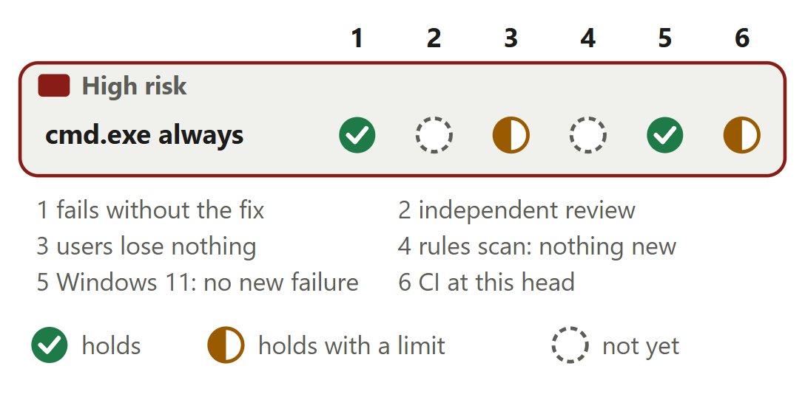

# Windows: Claude Code's hooks start one Node whatever PATH Claude Code has

For [pull request #963](https://github.com/neralabs/rerail/pull/963), head c557e3541. [report.html](report.html) is the same report as one page: download it and open it.

## 1. The decision

**May set-up write Claude Code's Windows hook entry through `cmd.exe` whatever its PATH, so each hook event starts one Node under any PATH?**

1. Where both PATHs find the recorded Node, hooks now start through `cmd.exe`, 9 ms slower.

**We recommend:** approve it: every hook keeps its fallback to `node.exe` from PATH, and nobody pays for a second Node because two shells saw different PATHs.

| Size | Risk and review | Waits on | Not verified |
|---|---|---|---|
| 286 lines in 8 files: 90 ship, 196 are tests and text | Careful. It edits `src/setup/`, a high-risk path: a code owner approves. | Nothing. No CI run on GitHub yet: not pushed. | 4 |

## 2. Intent, and the gap

| Change | Intended | Found | Now |
|---|---|---|---|
| One Node a hook | One Node a hook event _(code comment)_ | Two Nodes where the PATHs differ _(timed runs, Windows 11)_ | Closes the gap, changes answer 1. |

Found on 20 November 2026 on Windows 11, where Claude Code's PATH found an older Node than the one set-up recorded.

Sources at main, and causes

| Change | Where main states the intent | The cause, and what was measured |
|---|---|---|
| One Node a hook | `src/setup/harness-registration.ts` at b7c639830, line 583, the comment on `hookExecEntry`: "cmd starts the recorded node itself while it exists and `node.exe` from PATH once it is gone, one node either way." Line 587, `hookExecEntry`, writes the `node` entry when `pathFindsNode` (line 711) finds the recorded node on set-up's PATH. | Set-up chose the entry from the PATH of the process running it. Claude Code starts hooks with its own PATH, which a version manager's shell, an editor started from another shell or a later installer can make differ. There `node` ran the hook launcher on the other Node, and the launcher started the recorded one: a counter loaded in every Node through `NODE_OPTIONS` read 2 Nodes a call, 5 calls an entry. |

## 3. Where to look

1. **Read first**, 10 min: `harness-registration.ts`: `hookExecEntry`, `cmdHookEntry`, `keptHookEntry`. Can an entry an earlier version wrote stop counting as connected, or `cmd.exe` get a path it would split?
2. 1 min: `hook-launcher.ts`: its header comment only.

**Then skim**, 5 min: The tests: one case registers under five set-up PATHs and expects the `cmd.exe` entry each time; a Windows case starts it as Claude Code does and reads the hook's parent.

## 4. Risk against verification

One change, high risk by its path: set-up now writes, under every PATH, the entry 0.1.5 writes where its PATH finds another Node.

Each limit, and each check that does not hold yet

| Change | Check | Its limit, or why it does not hold yet |
|---|---|---|
| cmd.exe always | independent review | No independent reviewer has read it yet: our own reading of the diff and its tests only. |
| cmd.exe always | users lose nothing | Every hook keeps its fallback to `node.exe` from PATH and its exit 0 when the recorded Node cannot start, as 0.1.5's `cmd.exe` entry does, and an entry already registered still counts as connected. Where both PATHs find the recorded Node, a hook also pays for `cmd.exe`'s start. |
| cmd.exe always | rules scan: nothing new | The automated reviewer's rules have not run over this diff yet. |
| cmd.exe always | CI at this head | No CI run at this head on GitHub yet: the branch is not pushed. The commit hook's `npm run check` passed. |

## 5. The changes

**The `cmd.exe` entry under any PATH**, high risk: Another Node first on Claude Code's PATH, Windows 11: `node` entry 223.4 ms, 2 Nodes; `cmd.exe` entry 192.9 ms, 1.

<b>6. The decisions</b>

**Which hook entry should set-up write on Windows, whatever its own PATH?** (ask 1)

**We chose** `cmd.exe` always: one Node under any PATH, the fallback kept, and no PATH set-up reads tells it Claude Code's. **Would change our mind:** A maintainer who prefers a link Rerail keeps to the recorded Node, or a machine where `cmd.exe` starts far slower.

| Option | What a user gets | Cost | What it breaks |
|---|---|---|---|
| `cmd.exe` always, wherever it can start the paths **(chosen)** | One Node a hook event under any PATH, and `node.exe` from PATH once the recorded Node is gone. | About 9 ms a hook over one `node` process (16.6 ms on a busier machine): `cmd.exe`'s start and its `if exist`. | Nothing found. A path `cmd.exe` would split still gets the `node` entry. |
| `main`: the entry chosen by set-up's PATH, with or without a report | No extra cost where both PATHs find the recorded Node; with a report from the launcher, `rerail status` could name a second Node. | 40 to 52 ms a hook over one `node` process wherever the PATHs differ, until someone acts; a report needs a new path from hook to daemon. | Today nothing tells the person, and set-up's PATH tells nothing of Claude Code's. |
| The recorded Node by its full path as the command | One Node under any PATH, at about the cost of one `node` process. | None measured. | Every hook fails to start once a version manager removes that Node, until set-up runs again. |
| A link Rerail keeps to the recorded Node | One Node under any PATH, at about the cost of one `node` process. | A refresh at each Node upgrade, and the same volume or an 80 MB copy. | It keeps running a Node its owner uninstalled, whose security fixes have stopped. |

**Evidence.** `main` b7c639830 set up as a person does on two Windows 11 machines (8 cores), Node 24 recorded and Node 22 first on the hook's PATH, 50 PreToolUse calls each, Node processes counted: `node` entry 223.4 and 258.6 ms at the median, 2 Nodes; `cmd.exe` entry 192.9 and 222.9 ms, 1 Node; `node` entry with Node 24 first 183.9 and 206.3 ms. `cmd.exe` always costs less overall once one person in four meets differing PATHs.

<b>7. How it fits</b>

Nothing has to merge first: it stands on `main` b7c639830, and Git merges `main` d93d74b74 into it with no file both changed. #959 also edits `hook-launcher.ts` and `docs/windows.md`: this change edits only the launcher's header comment and the docs' hook table; a trial merge is clean.

<b>8. What is not covered</b>: 4 not verified, 1 smaller gap, 2 limits that stay

1. **macOS** never ran; its entries do not change.
2. **An independent review** has not read the change yet.
3. **The automated reviewer's rules** have not run over this diff yet.
4. **A slow `cmd.exe`** was not timed: a machine whose policy slows `cmd.exe` would pay more for each hook (`/d` already skips AutoRun).

**Smaller gaps**

- **This head's own times.** It was timed on a machine at 99 to 100% CPU from other work: its medians show one entry under every PATH, and the cost comparison rests on the runs at `main`. A quiet machine's run would close it.

**Limits that stay**

- An entry already registered keeps working and still counts as connected; `rerail update`, set-up and `rerail install --refresh` write the `cmd.exe` entry over it, and Claude Code sessions take it when they next start.
- A path `cmd.exe` would split (one holding `%`, `!` or `"`), or a `SystemRoot` with no full path to `cmd.exe`, still gets the `node` entry and its second Node where the PATHs differ.

## 9. What we ask of you

Ask 1 rules on answer 1.

1. **May every Windows hook start through `cmd.exe`, about 9 ms slower where both PATHs find the recorded Node?** We recommend yes: set-up cannot see the PATH Claude Code starts hooks with.

<b>10. Evidence</b>

The description's "How you tested it" holds every run at `main` and here.

| Where | What ran | Result |
|---|---|---|
| Linux x64 and Windows 11 | `harness-registration.test.ts` with the new tests alone on `main` b7c639830; the four changed or importing test files at this head | At `main`: Windows 11, 2 failed (the hook's parent was `node.exe`), 95 passed; Linux x64, 1 failed, 133 passed. Here: Windows 11, 130 passed; Linux x64, 168 passed. |
| Windows 11, two machines, 8 cores | `main` set up as a person does, Node 24 recorded, Node 22 first on the hook's PATH; 50 PreToolUse calls an entry, started as Claude Code starts a hook, Node processes counted | Quieter machine: `node` entry 223.4 ms at the median, 2 Nodes; `cmd.exe` entry 192.9 ms, 1 Node; `node` entry with Node 24 first 183.9 ms, 1 Node. Busier: 258.6, 222.9 and 206.3 ms. `node -e 0` 38 to 47 ms; `cmd.exe /d /c exit 0` 17.5 ms. |
| Windows 11, 8 cores | This head packed and set up with `npx @neralabs/rerail setup` from a local registry, Node 24 first on set-up's PATH, then registered again with Node 22 first; 50 calls under each PATH | The `cmd.exe` entry for all nine events; the second registration changed no byte of `settings.json`; one Node a call under every PATH; 228.2, 229.0 and 226.4 ms at the median on a machine at 99 to 100% CPU from other work. |
| Windows 11, 8 cores | The issue's steps with the published 0.1.5, 20 calls each | One Node and 127 ms at the median with set-up's PATH; two Nodes and 169 ms with Node 22 first. |

**Sources.** The branch at 04f0fe7c0 and its diff against `main` b7c639830, read on 20 November 2026; a trial merge with `main` d93d74b74; runs on Windows 11 virtual machines and Linux x64 machines at `main` b7c639830, at b0b3c94a4 (its new tests alone) and at this head.

