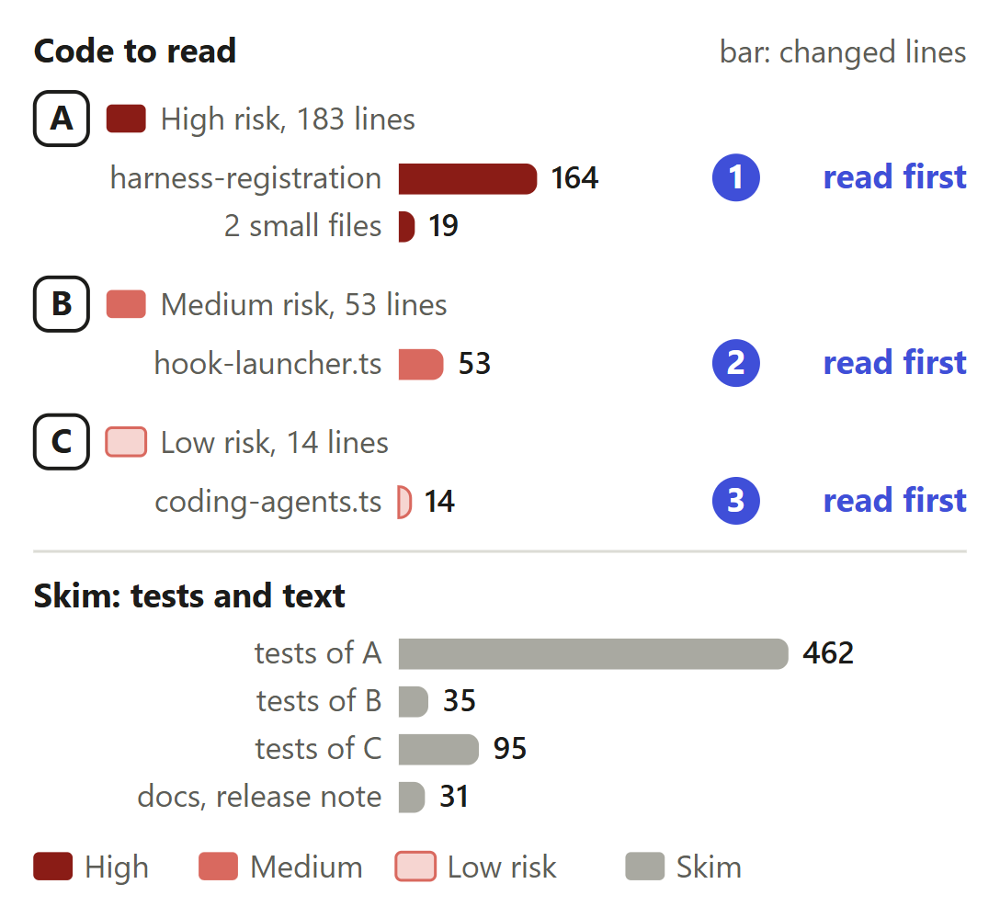
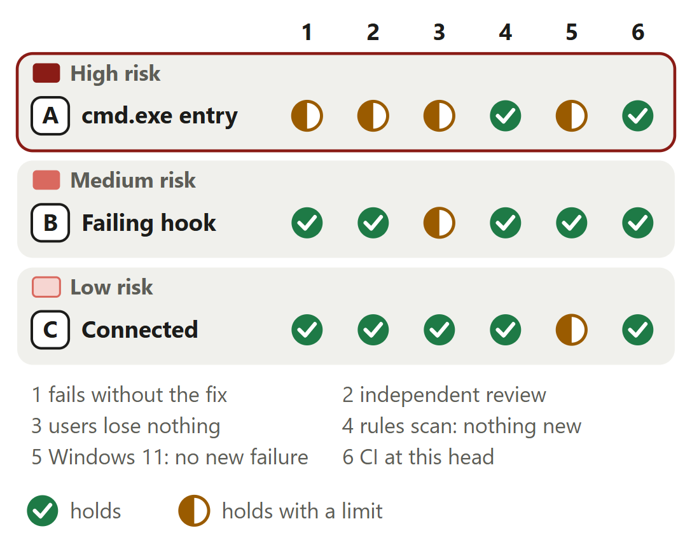

# A Claude Code hook on Windows runs in one Node

For [pull request #656](https://github.com/neralabs/rerail/pull/656), head eb88b0dee. [report.html](report.html) is the same report as one page: download it and open it.

## 1. The decision

**With another node first on PATH, does each Claude Code hook event on Windows run in one Node, and every other setup keep `main`'s entry?**

1. Where set-up's PATH finds another `node`, the hook entry starts `cmd.exe`. **Changes the intent.**
2. One setup then costs more per event than `main`. **Changes the intent.**
3. A late hook failure on the `node` entry exits 0.

**We recommend:** rule first on #655's open question (is a `cmd.exe` hook entry acceptable there, or do you prefer another way), since this pull request builds the `cmd.exe` entry and changes to whatever you prefer.

| Size | Lane | Waits on | Not verified |
|---|---|---|---|
| 873 lines in 12 files: 250 ship, 623 are tests and text | Careful. A code owner approves. | #655's answer. No maintainer has answered it. | 5 |

## 2. Intent, and the gap

| Change | Intended | Found | Now |
|---|---|---|---|
| A. The entry's command | `node` from PATH starts the launcher _(code comment)_ | Two Nodes per event _(medians, 20 runs)_ | **CHANGES THE INTENT: ANSWER 1.** Starts the recorded Node through `cmd.exe`. A maintainer must agree. |
| A. Which PATH chooses | One entry, whatever PATH _(our reading)_ | Crossed PATHs cost more than `main` _(20-event medians)_ | **CHANGES THE INTENT: ANSWER 2.** Set-up's PATH chooses the form. A maintainer must agree. |
| B. A failing hook | A failed hook exits 0 with `{}` _(code comment)_ | Own process: five answers differ _(Windows 11)_ | Closes the gap, changes answer 3. |
| C. The connected check | Connected: a dry run writes nothing _(code comment)_ | With two forms, another PATH misreads it _(a failing test)_ | Closes the gap. |

Measured on 13 November 2026, Windows 11, Node 24.21.0.

Sources at main, and causes

| Change | Where main states the intent | The cause, and what was measured |
|---|---|---|
| A. The entry's command | `src/setup/harness-registration.ts` lines 519 and 520, above `hookExecEntry`: "The same recorded-first, PATH-fallback order without a shell, for hosts that spawn exec-form hooks directly: \`node\` from PATH starts the hook launcher, which hands the hook to the recorded node while that binary exists." `src/harness/hook-launcher.ts` lines 4 and 5 add that "the \`cmd\` fallback the shell-form registrations use is unavailable". | `hookExecEntry` at `main` (line 522) writes the command `node` on every Windows computer, and Claude Code finds it on PATH. Where that is another file, the launcher starts the recorded Node with `spawnSync` (`hook-launcher.ts` line 43). Measured at `main` 383fc99aa, Windows 11, Node 24.21.0, started as Claude Code starts it: 2 Nodes, the hook's parent `node.exe` with 50.8 MB of working set. With the `cmd.exe` entry: 1 Node, parent `cmd.exe`, 8.5 MB. A maintainer confirmed the defect at f277c6e29. |
| A. Which PATH chooses | Nothing at `main` writes it down. `hookExecEntry` (`src/setup/harness-registration.ts` lines 522 to 528) returns the command `node` and the same three arguments on every call: it reads no PATH. | `hookExecEntry` at the head asks `pathFindsNode`, which reads the PATH of the process that plans the registration: set-up, `rerail install --refresh` or `rerail update`. Claude Code may run with another. Measured on a Windows 11 desktop, Node 24.21.0, `main` at a9101752c against the entry and launcher as at 7cf80b2b4, 20 interleaved events per form: 45.0 ms with `main`'s entry, 59.8 ms with the `cmd.exe` entry. A second run from a separate checkout measured about 17 ms and 8 MB more. |
| B. A failing hook | `src/harness/hook-launcher.ts` lines 25 and 26, above `quiet`: "A hook that could not run, or failed, answers nothing rather than failing: an agent shows a failed hook as an error under every tool call. \`{}\` stands in for an answer the hook never wrote." `docs/threat-model.md` line 467: "The launcher turns a non-zero exit into exit 0 and \`{}\`". | At `main` the own-process branch (lines 52 to 57) reads `process.exitCode` once the import returns, and answers `{}` for a failed import. `process.exit(3)` and a late throw keep their exit codes, 3 and 1. A failing `exitCode` with nothing written gets no `{}`. A hook that answers and then throws while loading gets `{}` after its answer. Measured on Windows 11, Node 24.21.0, `main` at c438bc813 against c608e733e, each entry started with no shell, a hidden window and the event on stdin. |
| C. The connected check | `src/setup/coding-agents.ts` lines 57 and 58, above `codingAgentStates`: "whether Rerail is connected to it (a dry run of registering it against \`root\` would write nothing)". `connection` at `main` (line 76) plans that dry run with no platform and no option. | `rerail status` asks from the shell and the dashboard from the daemon, each with a PATH of its own. The test "reads a Windows hook entry in either form as current when asked to keep it, whatever PATH finds" read `updated` before `keepHookCommand`. `connection` at `main` also plans for the platform it runs on, not the one it is asked about: over `main`'s code three coding-agent tests fail on Linux x64 and one on Windows 11 (eb88b0dee). |

## 3. Where to look

1. **Read first**, 8 min: `harness-registration.ts`: `execHookEntries`, `cmdHookArgs`, `isWindowsCmd`. Can any `SystemRoot` or path make the entry start nothing, or a repository's file?
2. **Read first**, 3 min: `hook-launcher.ts`: `watchAnswer`, the `exit` listener. Can a hook that answered get a second `{}`?
3. **Read first**, 2 min: `coding-agents.ts`: `connection`. Can an entry that starts nothing still read as connected?
4. 1 min: A: `same-file.ts`, `parent-watch.ts`.

**Then skim**, 5 min: Read the squashed diff: commit 5 replaces the design of commits 1 and 3. Two `coding-agents.test.ts` tests now skip on Windows; their `win32` assertions move to new tests.

## 4. Risk against verification

A's half marks: no real Claude Code event, one costlier setup, `DisableCMD` not measured.

Each half mark's limit

| Change | Check | It holds with this limit |
|---|---|---|
| A. cmd.exe entry | fails without the fix | At eb88b0dee, over `main`'s code for the five source files, the registration tests fail in 14 places on Windows 11 and 13 on Linux x64; the end-to-end test reports the hook's parent as `node.exe`. Each guard line removed fails a test. The limit: on Linux no test pins the default read of `cmd.exe`'s file; only the Windows end-to-end test does. |
| A. cmd.exe entry | independent review | Second runs from a separate checkout found three defects, each fixed: a `SystemRoot` of `\Windows` (a8d6abfe7), an earlier entry left in place (af2275d72), a path with no `cmd.exe` at it (eb88b0dee). At eb88b0dee no `SystemRoot` case gives a person less than `main`. The limit: the automated reviewer keeps one follow-up open, a real Claude Code event. |
| A. cmd.exe entry | users lose nothing | Entries written by 0.1.3, 0.1.4 and `main` are read, replaced and removed, and a person's own `cmd.exe` hooks stay: 102 settings on Windows 11, 96 on Linux x64. The limits: one case costs about 10 to 17 ms and 8 MB more per event than `main`; a computer with `DisableCMD` was not measured; going back needs `rerail install --remove` first. |
| A. cmd.exe entry | Windows 11: no new failure | At eb88b0dee, Windows 11, Node 24.21.0, the 18 test files that import a changed module: 369 passed, 48 skipped, 1 failed. The limit: that one, in `claude-status.test.ts`, runs no code this change edits, and `main` fails it under load too (#681). A second run of the changed test files with a probe: 201 passed, 39 skipped, 0 failed. |
| B. Failing hook | users lose nothing | In the issue's case all seven hooks get the answer `main` gives. The limit: on `main`'s `node` entry, where PATH finds the recorded Node, five of the seven answers change on purpose (answer 3), and a late failure no longer shows as a hook error. A native crash or an out-of-memory abort keeps its exit code. |
| C. Connected | Windows 11: no new failure | At eb88b0dee on Windows 11, Node 24.21.0, the changed test files with a probe: 201 passed, 39 skipped, 0 failed. CI on `windows-2025` ran the coding agents' 18 tests: 2 skipped, none failed. The limit: `main` runs those 2 on Windows and this change skips them there. Their `win32` assertions run in new tests, their Linux checks off Windows only. |

<b>5. The changes</b>

**A. The `cmd.exe` hook entry**, high risk. Nodes per event where PATH finds another `node`: 2 at `main`, 1 here.

- **Problem:** Where the first `node` on PATH is not the Node that ran set-up, every Claude Code hook event starts two Nodes: the launcher on PATH's, the hook in the recorded one. With no `node` on PATH, no hook starts.
- **Who meets it:** A Windows computer whose first `node` on PATH is another file, on every hook event. One started 1,615 launchers and 1,615 hook processes in 15 minutes of sessions (#655). How many installs have such a PATH is not known.
- **What it does:** `hookExecEntry` asks `pathFindsNode`. Where PATH finds the recorded Node it writes `main`'s `node` entry. Elsewhere `execHookEntries` writes System32's `cmd.exe` with `cmdHookArgs`, each word an argument of its own, but only when `isFullWindowsPath` holds, a file is there and `cmdReadsAsOneWord` passes every path. `launcherArgs` and `isWindowsCmd` read both forms back.
- **Risk:** High. It is the command of every Rerail hook Claude Code runs there, in `src/setup/`, a high-risk path. A wrong entry starts nothing, or a file the repository holds. A wrong read-back takes a person's own hook.
- **Check:** `cmdHookArgs`: can a path with a space, `&` or `%` reach `cmd.exe` split? `/d` skips AutoRun, and `NoDefaultCurrentDirectoryInExePath` keeps the fallback `node.exe` to PATH. `isWindowsCmd` asks only for `cmd.exe` in a folder named `System32`, with no file check, so an entry whose `cmd.exe` has gone is still replaced; `cmdLauncherArgs` then requires Rerail's exact words. Could a person's own hook pass both? `execHookEntries` tests the path's form before it looks for the file.
- **Picture:** Median time of one hook event on a Windows 11 desktop. Node 22 first on PATH: 85.8 ms at main, 62.4 ms here. Another Node 24 file first: 80.2 ms and 60.1 ms. Set-up under Node 22 and events with the recorded Node first: 45.0 ms at main and 59.8 ms here, the one case that costs more.
- **Method:** one Windows 11 x64 desktop, Node 24.21.0. `main` at a9101752c against this branch's entry and launcher as at 7cf80b2b4. A hook that only answers, each entry started with no shell, a hidden window and the event on stdin: 20 interleaved events per form after 3 warm-up rounds. The two sides are two runs, each beside other test runs.

**B. A failing hook's answer**, medium risk. Own-process answers like a child's, of seven hooks: 2 at `main`, 7 here.

- **Problem:** The `cmd.exe` entry runs every hook in the launcher's own process. There `main` keeps a failing hook's exit code, which Claude Code shows as a hook error, or answers no `{}`, or adds `{}` after an answer.
- **Who meets it:** At `main`, a Windows computer whose PATH finds the recorded Node, when a hook fails after it has loaded. With the `cmd.exe` entry, every computer this fix reaches. Source: seven hooks started through each entry on Windows 11.
- **What it does:** `watchAnswer` wraps `process.stdout.write` and notes any write of one character or more. An `exit` listener calls `quiet` when the code is not 0: it names the code on stderr, writes `{}` only when nothing was written, and sets exit code 0. The `catch` around the import asks `watchAnswer` too. The check after the import goes.
- **Risk:** Medium. The answer Claude Code gets from a failed hook changes on `main`'s `node` entry too: exit 0 where it kept the hook's code. A wrong count writes `{}` after a real answer, or none.
- **Check:** Does every answer a hook writes go through `process.stdout.write`? One written straight to file descriptor 1 would count as silent and get `{}` after it. In the `exit` listener, does `{}` always reach the pipe before the process ends? The five cases pass on Windows and Linux. A native crash or an out-of-memory abort never reaches the listener and keeps its code.
- **Picture:** Of seven test hooks, how many get the answer main's child path gives. With the recorded Node first on PATH, where the launcher runs the hook in its own process: 2 at main, 7 here. With another node first: 7 at main, where the hook runs as a child, and 7 here through cmd.exe.
- **Method:** Windows 11, Node 24.21.0. Seven hooks, one that answers and six that fail or end the process in different ways, each started through the entry each commit's set-up writes, with no shell, a hidden window and the event on stdin. `main` at c438bc813 against c608e733e; `hook-launcher.ts` has not changed from 6383e9c2e to eb88b0dee. Exit code and stdout compared.

**C. The connected check**, low risk. Coding-agent tests failing over the code of `main`, Linux x64: 3. Here: none.

- **Problem:** Set-up now writes one of two forms, chosen from its PATH. `rerail status` asks from the shell, the dashboard from the daemon, each with its own PATH: a plain dry run would read a current entry as out of date.
- **Who meets it:** Anyone on Windows whose shell or daemon runs with another PATH than set-up did, each time they open the dashboard or run `rerail status`. Source: the test of either form, which read `updated` before `keepHookCommand`.
- **What it does:** `connection` plans its dry run with `keepHookCommand`, the platform it is asked about and `fileExists`. `keptHookEntry` in `harness-registration.ts` keeps the entry the settings hold when it runs the same launcher, Node and hook in either form. A `cmd.exe` entry with no file at its path is not kept, so it reads as out of date and a refresh replaces it.
- **Risk:** Low. A dry run that writes nothing. A wrong answer shows Claude Code as connected, or not, in `rerail status` and the dashboard. Set-up and `rerail update` leave the option off.
- **Check:** Only `connection` passes `keepHookCommand` in `src`. `keptHookEntry` returns the other form only when the settings hold exactly that command and those arguments (`holdsHookEntry`), so an entry a person has edited is not taken for current. Is a `cmd.exe` entry whose file has gone the only one that must read as out of date?
- **Picture:** Tests of test/setup/coding-agents.test.ts that fail. Over main's code for the changed source files: 3 on Linux x64 and 1 on Windows 11. At eb88b0dee: none on either.
- **Method:** the branch's `test/setup/coding-agents.test.ts` at eb88b0dee over `main`'s code for the five source files this change edits, which `main` has not changed since the merge base 383fc99aa: Linux x64 and Windows 11, Node 24.21.0. Then the same file at eb88b0dee.

<b>6. The decisions</b>

**One Node per event through `cmd.exe`, or another way?** (ask 1)

**We chose** System32's `cmd.exe`: it keeps the fallback to PATH's `node.exe`. **Would change our mind:** an answer on #655, a window shown for `cmd.exe`, or a policy that refuses its line.

| Option | What a user gets | Cost | What it breaks |
|---|---|---|---|
| `cmd.exe` where set-up's PATH finds another `node`, or none **(chosen)** | One Node per event, and PATH's `node.exe` once the recorded Node is gone. | One `cmd.exe` per event there: 8.5 MB of working set (the tree of dcf577dda). | Older versions do not read the entry as theirs. Not measured where policy blocks the command prompt. One case costs more than `main` (the next decision). |
| The recorded Node itself as the command (commits 1 and 3) | One Node per event and no `cmd.exe`. | Nothing per event. | Once a version manager removes that Node, no hook starts until `rerail install --refresh`. Started that way on Windows 11 with the Node renamed away, the entry failed with `ENOENT`. |
| `node` for everyone, as on `main` | The fallback to PATH's Node. | A second Node per event where PATH finds another: 50.8 MB, and 76.0 ms against 52.2 ms at the median. | No hook starts where PATH has no `node`. |
| `cmd.exe` for every Windows user | One form, and no case that depends on PATH. | About 10 ms and 8 MB per event where PATH finds the recorded Node: 48.7 ms for the `node` form against 59.8 ms. | It changes the entry for people this bug does not reach. |

Before: At main, where PATH finds another node: Claude Code starts node from PATH, that Node runs the hook launcher, the launcher starts the recorded Node as a child, and the recorded Node runs the hook. Two Node processes per event. After: Here, where set-up's PATH found another node: Claude Code starts cmd.exe by its System32 path. While the recorded Node exists, cmd.exe starts it, and it runs the launcher and the hook in one process. Once it is gone, cmd.exe starts node.exe from PATH. One Node per event either way.

**Evidence.** The end-to-end test `starts a Windows hook as Claude Code does, in one node: the recorded one, and once it is gone node.exe from PATH` registers with the launcher the package ships, the recorded Node in a folder named `node (24) & é` and a `node.exe` in the hook's working folder. It expects `cmd.exe` as the hook's parent, then renames the recorded Node away and expects PATH's `node.exe`. Over `main`'s code it fails with the parent `node.exe`.

**Which PATH chooses the entry's form?**

**We chose** the writing command's own PATH (ask 2). **Would change our mind:** a maintainer who accepts a settings write the person did not ask for.

| Option | What a user gets | Cost | What it breaks |
|---|---|---|---|
| The command that writes the entry chooses from its own PATH **(chosen)** | As on `main`, only a command the person runs writes `~/.claude/settings.json`. | Where that PATH found another `node` and Claude Code's finds the recorded Node: about 10 to 17 ms and 8 MB more per event than `main`, until set-up runs again from a PATH that finds the recorded Node. | Nothing checked, steered or recorded. |
| `cmd.exe` for every Windows user | No case depends on PATH. | About 10 ms and 8 MB per event for everyone whose PATH finds the recorded Node. | Nothing. |
| The daemon or a hook rewrites the entry when it sees the costly form | The case ends with no command from the person. | A write of the person's settings during a session. Read in the code, not run: Claude Code writes that file too, and one of the two writes can be lost. | Not built. |

**Evidence.** On a Windows 11 desktop, Node 24.21.0, set-up with Node 22 first on PATH and events with the recorded Node first: 45.0 ms at the median with `main`'s entry (a9101752c) and 59.8 ms with the `cmd.exe` entry (as at 7cf80b2b4), 20 interleaved events each. A second run from a separate checkout, with the same entry and launcher, measured about 17 ms and 8 MB more. The mirror case keeps `main`'s `node` entry and its two Nodes.

**What does a hook failing in the launcher's process answer?** (ask 3)

**We chose** exit 0, and `{}` only when the hook wrote nothing, as a child's. **Would change our mind:** a maintainer who wants a late failure to stay a hook error.

| Option | What a user gets | Cost | What it breaks |
|---|---|---|---|
| Exit 0, and `{}` only when the hook wrote nothing **(chosen)** | In the issue's case, the answer `main` gives for all seven hooks of the description's table. | One function call per write to stdout, in the hook's process. | On `main`'s `node` entry a late failure no longer shows a hook error. A native crash or an out-of-memory abort keeps its exit code, and `docs/threat-model.md` says so. |
| Keep `main`'s own-process answers | No change on `main`'s `node` entry. | Nothing. | In the issue's case three failing hooks get no `{}` and one gets `{}` after its answer (measured at 7cf80b2b4). |
| `\|\| exit /b 0` at the end of the `cmd.exe` line | Exit 0 for every failure. | Nothing. | It also hides a hook that never ran because no Node started. |

Before: At main with the recorded Node first on PATH, four failing hooks. process.exit(3) before it writes: exit 3, nothing on stdout. A late throw: exit 1, nothing. process.exitCode = 3 with nothing written: exit 0, nothing. An answer, then process.exit(3): exit 3, the answer. After: On this branch, through either entry, the same four hooks. process.exit(3) before it writes: exit 0 and {}. A late throw: exit 0 and {}. process.exitCode = 3 with nothing written: exit 0 and {}. An answer, then process.exit(3): exit 0 and the answer.

**Evidence.** Windows 11, Node 24.21.0, the entry each commit's set-up writes, started with no shell, a hidden window and the event on stdin: seven hooks at `main` c438bc813, at 7cf80b2b4 and at c608e733e, under both PATH orders. `hook-launcher.ts` has not changed from 6383e9c2e to eb88b0dee. Five cases in `hook-launcher.test.ts` run each hook both ways and expect one answer; they fail over `main`'s code.

<b>7. How it fits</b>

It stands on `main` alone and merges clean at c89f068ed.

Pull request #656 is based on main at 383fc99aa and needs no other change. It waits on the open question on issue #655, which no maintainer has answered. Nothing waits on it. In trial merges it merges clean with twelve open pull requests that share docs files only, and with main at c89f068ed, which has changed three of its files since the base.

**Shared files.** Trial merges of eb88b0dee, read on 14 November 2026. #508, #562, #640, #645 and #667 (the team's) and #648, #657, #672, #676, #677, #678 and #680 (ours) share docs files only, and each merge is clean. Of the 28 open pull requests, no other edits a source or test file of this one. #563 (ours, an open issue) proposes a refactor of the hook entry code and has no pull request. Since the base 383fc99aa, `main` has changed three of this branch's files, with no conflict.

<b>8. What is not covered</b>: 5 not verified, 6 smaller gaps, 8 limits that stay

1. **Not run: a real Claude Code event** through the `cmd.exe` entry.
2. **Not measured: `DisableCMD`,** a policy that blocks the command prompt; set-up still writes the `cmd.exe` entry.
3. **One setup costs more than `main`:** set-up's PATH finds another `node`, Claude Code's the recorded one. About 10 to 17 ms and 8 MB more per event.
4. **Going back to an older Rerail** needs `rerail install --remove` first; the release note says so.
5. **No person has reviewed it,** only the automated reviewer.

**Smaller gaps**

- **Why no real event ran.** CI's job with real Claude Code sessions runs on macOS only, and no Windows machine the tests ran on has Claude Code. The end-to-end test starts the entry with no shell, a hidden window and the event on stdin.
- **What `DisableCMD` could cost.** `cmd.exe` is present on such a computer, so set-up writes the `cmd.exe` entry. Whether Windows then refuses its `cmd /d /c` line was not run. The `node` entry of `main` does not go through `cmd.exe`.
- **The mirror setup stays as on `main`:** two Nodes per event where set-up's PATH finds the recorded Node and Claude Code's finds another.
- **The default file read on Linux.** No Linux test pins the default read of `cmd.exe`'s file to the computer's own files: a default that never finds `cmd.exe` passes every Linux test. Only the Windows end-to-end test fails on it, in CI's Windows unit job.
- **The one Windows 11 failure.** `test/hosts/claude/claude-status.test.ts` failed one test in the 18-file run at eb88b0dee, beside 5 other test runs. It runs no code this change edits, and `main` fails it under load too (#681).
- **Outside CI,** macOS and the whole test suite did not run at this head. Linux and macOS registrations are the same, file for file, at `main` and here. CI ran the suite on Linux and `windows-2025`, and its job with real sessions on macOS.

**Limits that stay**

- Going back to an older Rerail needs `rerail install --remove` at this version first: an older set-up adds its `node` entry beside each `cmd.exe` entry, so each hook runs twice.
- An older Rerail's removal leaves the `cmd.exe` entries, which exit 1 on every event once its install is gone. Claude Code shows a hook error and goes on.
- Where `SystemRoot` gives `cmd.exe` no full path, or no file is at that path, set-up writes `main`'s `node` entry, word for word, with its two Nodes where PATH finds another.
- A launcher, Node or hook path that `cmd.exe` would split keeps `main`'s `node` entry too: one with `%`, `!` or a double quote, or one with no space that holds `&`, a bracket or another `cmd.exe` operator.
- One `cmd.exe` per event stays where the entry starts it: 8.5 MB of working set, measured at the tree of dcf577dda.
- When Claude Code gives up on a hook it ends `cmd.exe`, and Windows leaves the Node running. The hook then ends itself once its parent is gone, as it does under `main`'s launcher.
- In the launcher's own process a native crash or an out-of-memory abort keeps its exit code. Claude Code shows it as a hook error and does not block on it; `docs/threat-model.md` says so.
- Linux and macOS registrations, Codex, Cursor, OMP, Pi and the status line are as on `main`.

## 9. What we ask of you

Asks 1 to 3 rule on answers 1 to 3.

1. **On [#655](https://github.com/neralabs/rerail/issues/655): is a `cmd.exe` hook entry acceptable, or do you prefer another way?** We recommend an answer there; this pull request follows it.
2. **May set-up's PATH choose the form, though one setup then costs more than `main`?** We recommend yes: only the person's commands write their settings.
3. **On the `node` entry, may a late hook failure exit 0 with no hook error?** We recommend yes: the child path of `main` already does.

<b>10. Evidence</b>

The description on GitHub is the record: "How you tested it" holds the runs and CI.

| Where | What ran | Result |
|---|---|---|
| CI on GitHub | The pull request's checks at eb88b0dee, read on 14 November 2026. CI is run 43551521095, first attempt | 33 checks: 20 pass, 13 are skipped, none fails. In the CI run 18 jobs pass and 3 are skipped (`Rust engine`, `Conformance`, `Conformance comment`). The other 10 skipped: 8 jobs of the automated reviewer and 2 that act on an approved commit. On `windows-2025`: `harness-registration.test.ts` 125 tests, 37 skipped; `coding-agents.test.ts` 18, 2 skipped; `hook-launcher.test.ts` 11; none failed. `Real Claude Code, Codex, and Cursor sessions` passes on macOS. |
| Windows 11 and Linux x64 | At eb88b0dee, the branch's three changed test files over `main`'s code for the five source files this change edits | Windows 11: 20 failed, 95 passed, 39 skipped. All 20 are this change's tests (launcher 5, coding agents 1, registration 14), none among `main`'s own Windows failures. The end-to-end test reports the hook's parent as `node.exe`. Linux x64: 21 failed (launcher 5, coding agents 3, registration 13), 131 passed, 2 skipped. |
| Linux x64, 32 threads | At eb88b0dee, the 18 test files that import a changed module, and the same from a separate checkout | 415 passed, 3 skipped, 0 failed, in each of the two runs. |
| Windows 11, Node 24.21.0 | At eb88b0dee, the same 18 files, beside 5 other test runs; then the changed test files with a probe, from a separate checkout | 18 files: 369 passed, 48 skipped, 1 failed, in `test/hosts/claude/claude-status.test.ts`, which runs no code this change edits and which `main` fails under load too (#681). The second run: 201 passed, 39 skipped, 0 failed, nothing outside `main`'s known Windows failures. |
| Windows 11 and Linux x64 | At eb88b0dee, what set-up writes with another node first on PATH: 17 `SystemRoot` values on Windows 11 and 16 on Linux, each under 4 answers to whether the file is there | 68 rows on Windows 11 and 64 on Linux x64, all as expected: the `cmd.exe` entry only where `SystemRoot` gives a full path with `cmd.exe` at it, `main`'s `settings.json` byte for byte elsewhere. With the two set-up files as at af2275d72 the same probe finds 22 rows that write a `cmd.exe` entry with no file at its path. |
| Windows 11 | At eb88b0dee, each entry started with no shell, a hidden window and the event on stdin, from a repository that holds files named `cmd.exe` at `Windows\System32` and `System32` | For the 7 values that write `cmd.exe`, the hook answered from the recorded Node with `cmd.exe` as its parent. For the 10 that write `node`, it answered with `node.exe` as its parent, as `main`'s entry does. No entry started the repository's file. |
| Windows 11 | `main`'s set-up and removal at a9101752c, which read hook entries as 0.1.4 does, over the entries 7cf80b2b4 writes | Set-up added its `node` entry beside each of 9 `cmd.exe` entries, and one event ran the hook twice. Removal left the 9 `cmd.exe` entries. With the install deleted, each exited 1 on every event. |
| Linux x64 | The automated reviewer's rules over the diff against the merge base, rules read at `main` c89f068ed | 40 rules, 0 new findings. No function this change adds or edits counts over 4, against the complexity rule's ceiling of 6. |

**What this report adds to the description**

- **Three changes, where the description lists five.** This report groups the description's first three rows (the `cmd.exe` entry, `main`'s entry where `cmd.exe` cannot be written, both forms read back) as change A: they are one file and one read. B is its fifth row and C its fourth.
- **Two answers marked as changes of intent.** The description names one open question on #655. This report marks two answers as changes of intent, the `cmd.exe` entry and the PATH that chooses its form, and asks for a ruling on each. The description's second decision says the second belongs on #655 too.
- **`main`'s own-process answers, counted.** The description's table of seven hooks shows that `main`, with the recorded Node first on PATH, gives two the answer its child path gives and five another. The description does not count them; this report does.
- **Two existing tests now skip on Windows.** A read of the test diff. `test/setup/coding-agents.test.ts` skips two tests on Windows that `main` runs there, the Claude Code sandbox test and the Cursor CLI test. Their `win32` assertions move to two new tests that run everywhere; their checks of a Linux registration now run off Windows only. The description names the commit (b01e21357) and not the skip.
- **An answer written past `process.stdout.write`.** A read of the diff. `watchAnswer` counts only what goes through `process.stdout.write`. A hook that wrote its answer straight to file descriptor 1 and then failed would get `{}` after it. Rerail's hooks answer through `emitHookOutput` (`src/harness/hook-adapter.ts`), which writes to `process.stdout`, so none does today. The description does not name this boundary.

**Sources.** The pull request, its diff, its checks, the automated reviewer's review and issue #655 on GitHub, read on 14 November 2026. Rerail at `main` (c89f068ed) for each quoted intent: `main` has not changed the five source files since the merge base 383fc99aa. The description for the runs, the measurements and the trial merges, each at the commit it names.

