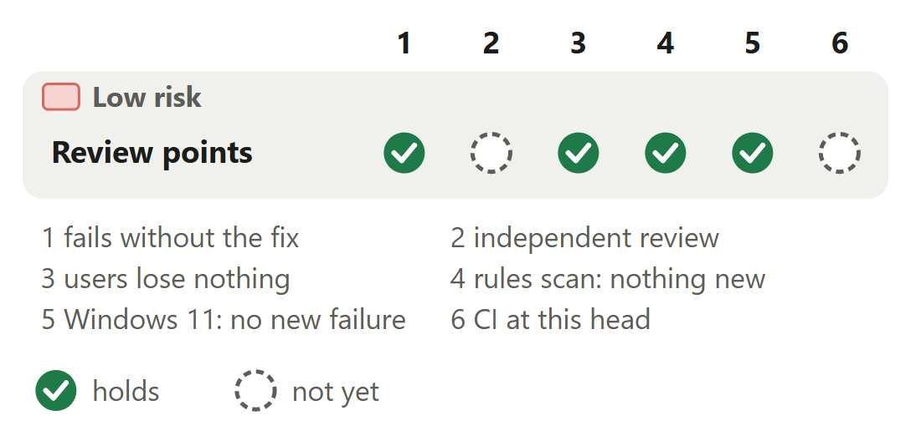

# Follow-up of #979: no challenge to a pipe Windows names as another's

For [pull request #1051](https://github.com/neralabs/rerail/pull/1051), head 64b57da86b. [report.html](report.html) is the same report as one page: download it and open it.

## 1. The decision

**May a Windows hook refuse a pipe Windows names as another process's, writing it no challenge, and say when Windows could not be asked?**

**We recommend:** approve it: it is the follow-up the approval of #979 named, each change of behaviour has a case that fails without it, and the home's own daemon gets its events as before.

| Size | Risk and review | Waits on | Not verified |
|---|---|---|---|
| 421 lines in 12 files: 109 ship, 2 run in every test run, 310 are tests and text | Standard. Product code on Windows hooks; a maintainer approves. | Nothing. It stands alone on main eefe9a74b. | 2 |

## 2. Intent, and the gap

| Change | Intended | Found | Now |
|---|---|---|---|
| F1: challenge to another | Another holder proves itself _(#979's description)_ | A challenge to a known other _(the approval of #979)_ | Closes the gap. |
| N1: Windows not asked | Every event, any version _(release note)_ | Nothing while the binding is out _(the approval of #979)_ | Closes the gap. |
| N2: timing written twice | One place for each wait _(docs)_ | Two files with the same waits _(the approval of #979)_ | Closes the gap. |
| N3: proofs per hook | One proof per hook _(code comment)_ | No hook-level count _(the approval of #979)_ | Closes the gap. |

Named on 23 November 2026 in the approval of #979: one follow-up and three nits.

Sources at main, and causes

| Change | Where main states the intent | The cause, and what was measured |
|---|---|---|
| F1: challenge to another | `src/runtime/daemon-control.ts` at 3b9b967d5, `provenEnginePipe`: a holder Windows names that is not the recorded daemon goes to `provedEndpoint`, which writes it the challenge. | Node opens pipes without `SECURITY_SQOS_PRESENT`, so a server holding `SeImpersonatePrivilege` can act as the person after that write. |
| N1: Windows not asked | `.changelog/fixed-windows-named-engine-pipe-proves-first.md` and `pipeServer` at 3b9b967d5, which gives undefined both where no pipe answers and where the binding cannot ask. | One value stood for no pipe and for Windows not asked, so the reason could not tell them apart. |
| N2: timing written twice | `docs/reference.md` at 3b9b967d5, line 642: one paragraph of 360 words that repeats the waits of `docs/threat-model.md` T14. | The reference gave the rule, the failures and the window arithmetic in one paragraph. |
| N3: proofs per hook | `src/runtime/daemon-control.ts` at 3b9b967d5, `provedSinceArrival`: the property rests on the start check noting its proof earlier in the same process. | The cases called `engineEndpointAt` with a deadline of their own, not a hook's. |

## 3. Where to look

1. **Read first**, 10 min: `daemon-control.ts`: `provenEnginePipe`, `provedEndpoint`, `heldElsewhereReason`, `notSentReason`. Is a holder with the recorded pid and a later start right to refuse with no proof?
2. 5 min: `engine-pipe.ts` and `daemon-machine.ts`: `pipeServer`'s three answers and the fake machine's default.

**Then skim**, 5 min: The slow engine of `claude-hook-rules.test.ts` now runs inside the daemon; the hook host's busy engine records its start after its process began.

## 4. Risk against verification

One change, low risk: start with the refusal in `provenEnginePipe`.

Each limit, and each check that does not hold yet

| Change | Check | Its limit, or why it does not hold yet |
|---|---|---|
| Review points | independent review | No review beside our own yet. |
| Review points | CI at this head | This pull request's CI is its first run on GitHub. CI's Lint and type-check job passes on Linux x64. |

## 5. The changes

**The four points of #979's approval**, low risk: A pipe Windows names as another process's: 2 challenges written at `main`'s code, none here.

<b>6. The decisions</b>

**Refuse a holder Windows names, or keep asking it and name the exposure?**

**We chose** refuse it outright and ask the proof only where Windows names no holder, the approval's first choice. **Would change our mind:** A daemon whose pipe Windows names with a pid other than the one its `daemon.json` records.

| Option | What a user gets | Cost | What it breaks |
|---|---|---|---|
| Refuse it outright **(chosen)** | No write to a pipe Windows names as another process's; the refusal at once. | Nothing for a daemon of any version: it records its own pid and serves its pipe. | A clock set back between the daemon's start and its record makes its start read later. |
| Ask it the proof, and name the exposure | The same events as now. | A line in the threat model. | A challenge written to a pipe known to be another's, on each hook event. |

**Evidence.** Windows 11 at `main`'s code: two events wrote two challenges to the pipe another process served; at this head none, and the hook names both processes.

**Where does the slow engine of the hook rules test run?**

**We chose** inside the daemon's own process, loaded with `--import`, so Windows names the daemon `daemon.json` records. **Would change our mind:** A way for the test's own process to stay recorded in `daemon.json` beside a running daemon.

| Option | What a user gets | Cost | What it breaks |
|---|---|---|---|
| The daemon's process serves it **(chosen)** | The case reaches a daemon `daemon.json` records, as the product's hooks do. | A module the test loads into the daemon by data URL. | Nothing found. |
| A relay in the test's process, recorded in `daemon.json` | The relay started as `resident-engine.test.ts` starts its engine. | A record the test writes. | The daemon writes `daemon.json` again within 1 s, so the record would not stay. |

**Evidence.** `src/daemon/daemon.ts`: the daemon checks `daemon.json` every 1 s and writes it again when it changed. Linux x64 and Windows 11 run the slow case 30 of 30.

<b>7. How it fits</b>

It stands alone on `main` eefe9a74b; nothing waits on it. #979, #964, #963, #997 and #975 are merged, and it holds all five.

**Shared files and trial merges.** #964 edited `daemon-control.ts`, the reference, the threat model and three of these test files, #963 the threat model, and #975 `daemon-control.ts`, the docs, two of these test files and the fake machine: each merge conflicted only in import lines, and each file keeps both changes. A 0.1.4 daemon Windows names as the holder of the pipe `RERAIL_ENGINE_SOCKET` names still gets its events, as #975 says; a pipe another process serves now gets not even the proof's challenge, so #975's case expects no proof there.

<b>8. What is not covered</b>: 2 not verified, 3 limits that stay

1. **GitHub's runners** This pull request's CI is the first run there.
2. **macOS** Not run; nothing here runs off Windows but the reason's text.

**Limits that stay**

- The start check still writes the proof's challenge to the pipe `daemon.json` names, and the lookup to a pipe Windows names no holder of; the threat model lists both.
- The check and the event still use two connections (threat model, T14).
- A clock set back between the daemon's start and its record makes Windows show its start after the record: the hook refuses that daemon, where `main`'s proof let it through.

## 9. What we ask of you

We ask no ruling.

<b>10. Evidence</b>

The description's "How you tested it" holds every run; "What is not covered" holds the limits.

| Where | What ran | Result |
|---|---|---|
| Windows 11 | The changed cases at `main`'s code, and with the refusal taken out | The event stream and Claude Code hook cases fail: 2 challenges where none is expected. |
| Windows 11 | The changed cases, 30 runs; the hook rules file, 30 runs | 30 of 30 each. |
| Windows 11 | The N3 case with the hook's deadline taken at its lookup | It fails: the hook asks Windows. |
| Linux x64 | The changed cases, 30 runs; the reason cases at `main`'s code and with each new line taken out | 30 of 30; each fails. |
| Linux x64 | The hook rules file, 30 runs | 30 of 30, at a load of 0 to 36. |
| Linux x64 and Windows 11 | Once: this change's test files, every test file `main` changed since the last head, and the files that import a changed module | All 29 unit files pass on Windows, and the 28 that run on Linux pass there. |
| Linux x64 | CI's Lint and type-check checks; the reviewer's rules; every integration file | Passed; nothing new; passed, the OMP files with the pinned OMP host as CI runs them. |
| Windows 11 | Every integration file, here and at `main` | The same 12 failures as at `main` on the same machine (no OMP host there), and no other. |

**Sources.** Test runs: vitest's own reports, on lab machines of Windows 11 and Linux x64.

