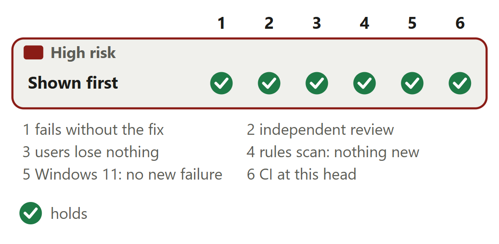

# On Windows a hook sends events only to its home's own daemon

For [pull request #979](https://github.com/neralabs/rerail/pull/979), head 7f999c574. [report.html](report.html) is the same report as one page: download it and open it.

## 1. The decision

**On Windows, may a hook send events to the pipe `RERAIL_ENGINE_SOCKET` names only once Windows or a proof shows it is the home's daemon?**

**We recommend:** approve it: at `main` other processes there got prompts and the capability; here only the home's own daemon gets events, as at `main`.

| Size | Risk and review | Waits on | Not verified |
|---|---|---|---|
| 1,398 lines in 23 files: 616 ship, 782 are tests and text | Careful. A code owner approves: it decides what leaves the machine. | Nothing. CI on GitHub has not run this head yet. | 3 |

## 2. Intent, and the gap

| Change | Intended | Found | Now |
|---|---|---|---|
| Named engine pipe | Challenge before any capability is sent _(docs)_ | Events and capability sent to any process _(Windows 11 runs)_ | Closes the gap. |

Found on 14 November 2026 on a Windows 11 virtual machine; shown again on 21 November at `main` 92fae67d8.

Sources at main, and causes

| Change | Where main states the intent | The cause, and what was measured |
|---|---|---|
| Named engine pipe | `docs/threat-model.md`, T2: the engine on that pipe must answer a random challenge with an HMAC keyed by the capability (`engineCapabilityProof`), which never shows it the capability. | `engineEndpointAt` in `src/runtime/daemon-control.ts` returned `daemon.json`'s capability whenever `daemon.json` named the pipe; the start check's refused proof stopped nothing; `hookDaemon` and the event stream call it for `RERAIL_ENGINE_SOCKET`. |

## 3. Where to look

1. **Read first**, 8 min: `daemon-control.ts`: `engineEndpointAt`, `provenEnginePipe`, `heldByRecordedDaemon`, `notSentReason`, `provedSinceArrival`. Can anything leave for a pipe Windows does not name as the recorded daemon's, whose engine gave no proof?
2. 6 min: `pipe_server.rs`, `engine-pipe.ts`, `native.ts`, `lib.rs`, `Cargo.toml`: the native call; `engine-service.ts`, `hook-host.ts`, `event-stream.ts`: the waits.

**Then skim**, 5 min: The Windows hook cases run another process on the pipe, and an older daemon that answers no proof, in processes of their own.

## 4. Risk against verification

Start at `provenEnginePipe`: it decides what leaves the machine on Windows.

## 5. The changes

**The engine pipe shown first**, high risk: At `main` another process on the named pipe got both events with the capability; here only challenges.

**6. The decisions:** we made no choice here that a maintainer could have made differently.

<b>7. How it fits</b>

Nothing merges first: it stands on `main` 1609ac3a3, the lines of #677 and #973 kept in the seven files it shares. #964 meets this head in six files; whichever lands second keeps both. #963 and #967 merge with it cleanly.

<b>8. What is not covered</b>: 3 not verified, 3 limits that stay

1. **A weak case** the hook's deadline taken at its lookup fails no case, 20 of 20 runs; it costs one call to Windows on that path, never an event.
2. **macOS** never ran; nothing changes there by the code.
3. **Native mutants** of the Windows-only glue were not run but one, the open's flags, which a Windows case fails; the loop runs with stand-ins on every system, and a busy pipe is checked on Windows.

**Limits that stay**

- Off Windows a socket the variable names that `daemon.json` does not name still gets events with no capability, as at `main`.
- A process that is not the recorded pid but proves has its proof's time taken off its event's 30 s; no run produced one.
- The check and the event use two connections: the threat model states the whole time between them, the session's lock included; closing it is a change of its own.

## 9. What we ask of you

1. **May an engine with no capability lose events through the variable on Windows?** We recommend yes: no command a person runs starts one.

<b>10. Evidence</b>

The description is the record: "How you tested it" holds the runs at `main` and at the head, the mutants and the files.

| Where | What ran | Result |
|---|---|---|
| Windows 11 | Claude Code's built hook entry, `main` 92fae67d8 against this change, 5 rounds each, and 5 more at this head | Another process on the named pipe: both events with the capability at `main`, only challenges here, 5 of 5 each time. |
| Windows 11 | The home's own daemon stalled 25 to 29 s while 12 or 24 prompt hooks arrive, 4 rounds | 240 of 240 hooks answered at `main` and here; every event reached it with the capability. |
| Windows 11 | One instance of the pipe held 45 s; the daemon stalled 40 s under 12 hooks | Held 45 s: the event arrived after 45.3 s at `main`, 45.4 s here. Stalled 40 s: 16 of 24 answered at both. |
| Windows 11 | Real Rerail 0.1.4 and 0.1.5 daemons, and the live daemon of this build, named by the variable | 0.1.4 and 0.1.5 each recorded both events and the prompt at `main` and here, 2 of 2; this build's daemon took 16 hooks at once at both. |
| Windows 11 | 50 hooks before a tool call to an idle daemon, 3 rounds | Median 185 ms at `main` and 191 ms here over 150 hooks a side; Windows asked, 194 and 189 ms; no process started. |
| Linux x64 | 6 one-line changes to the fix's lines, 20 runs each | 5 fail a case in every run; the hook's deadline taken at its lookup fails none. |
| Linux x64 | The 96 importing test files, against `main` | The same 956 failures at both, from pack test data the machine lacks; none more. |
| Linux x64 | At this head against `main` 1609ac3a3: the 97 test files that import a changed module, `integration/`, CI's lint and type-check job, rustfmt, clippy, the pipe lookup's Rust cases and the wasm32-wasip1 checks | 490 passed at `main` and 510 here, none failed; the rest all pass. |

**Sources.** The branch and its diff against `main` 1609ac3a3, read on 22 November 2026; the threat model at `main` for the quoted intent.

