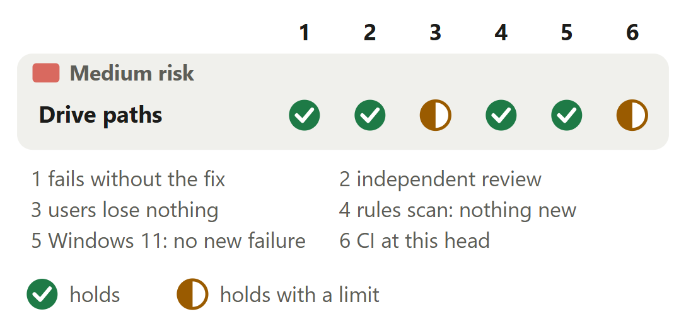

# Windows: no program started by a path from the drive root

For the pull request of branch `JeanFrancoisGagne/windows-program-path-from-drive-root`, not opened yet, head 9688d9ae4. [report.html](report.html) is the same report as one page: download it and open it.

## 1. The decision

**May Rerail on Windows refuse program paths from the drive root, like `\tools\git.exe`, and read such PATH entries on its folder's drive?**

1. Such paths are refused; programs under such PATH entries start by full path.

**We recommend:** approve it with answer 1: a program `main` found under such a PATH entry from the same drive, outside the repository Rerail runs in, is still found, by its full path.

| Size | Risk and review | Waits on | Not verified |
|---|---|---|---|
| 491 lines in 11 files: 140 ship, 351 are tests and text | Standard. No high-risk path; the automated reviewer can approve. | Nothing. No CI run on GitHub yet: not published. | 2 |

## 2. Intent, and the gap

| Change | Intended | Found | Now |
|---|---|---|---|
| The program-path check | Refuse what the folder could supply _(code comment)_ | A drive-root path passes the check _(one reading)_ | Closes the gap, changes answer 1. |

Found in November 2026 by reading the code; the cases ran on Linux x64 and Windows 11, on each `main` since.

Sources at main, and causes

| Change | Where main states the intent | The cause, and what was measured |
|---|---|---|
| The program-path check | `src/engine/child-process.ts` at `main` c21947263, lines 40 to 46, a code comment: "Refuses, on Windows, to start a program named by a bare name or a relative path: Windows looks for one in the current folder before PATH ... Rerail names every program by absolute path there". Line 52 tests `win32.isAbsolute(command)`. | Node's `win32.isAbsolute` answers true for a path that starts with one separator. Windows reads such a path on the drive of the spawn's folder. `programOnPath` (`system-programs.ts` line 52), `claudeGitBash` (`claude-status.ts` line 132) and `hookProgram` (`hook-command.ts` line 49) picked paths with the same test; Rerail's Git search already wanted a drive or two separators (`git.ts`, `trustedFolder`). |

## 3. Where to look

1. **Read first**, 6 min: `system-programs.ts`: `isFullyQualifiedWindowsPath`, `searchedFolder`, `fromCurrentDrive`. Does any path Windows reads from one fixed place fail the test, and can a repository folder get through?
2. 6 min: `child-process.ts`, `claude-status.ts`, `hook-command.ts`: the check and the two places that pick a path.

**Then skim**, 5 min: Tests that play Windows on Linux keep their Linux folders; the Windows PATH cases reach a folder as a drive of its own with subst.

## 4. Risk against verification

Start at check 3: a program in the repository Rerail runs in, under a PATH entry from the drive root, is no longer found.

Each half mark's limit

| Change | Check | It holds with this limit |
|---|---|---|
| Drive paths | users lose nothing | A program under a PATH entry from the drive root inside the repository nearest Rerail's folder, at any depth, is not found, as in Rerail's Git search. A bash `CLAUDE_CODE_GIT_BASH_PATH` names there no longer runs: the Git Bash beside Git runs the line, or the person sees its command text. |
| Drive paths | CI at this head | No CI run at this head on GitHub yet: the branch is not published yet. CI's integration job passed on Linux x64 at 3edd24f9c, before the last merge of `main`: 22 files, 90 tests. |

## 5. The changes

**Program paths name their drive**, medium risk: `\tools\git.exe` on Windows: started from the child's drive at `main`, refused here; a PATH entry `\tools` gets a drive.

<b>6. The decisions</b>

**How does the PATH search read an entry from the drive root, such as `\tools`?**

**We chose** on the drive of Rerail's current folder, named with it; skipped for a folder inside the nearest repository. **Would change our mind:** A person who keeps programs on PATH inside the repository they work in, such as a home folder kept as a Git repository.

| Option | What a user gets | Cost | What it breaks |
|---|---|---|---|
| On the current folder's drive, named with it; skipped inside the nearest repository **(chosen)** | Every program `main` found there from the same drive, outside the repository Rerail runs in; a start from another drive runs the file the search checked. | One file check per folder up to the repository or the drive root, only for such an entry: about 400 us a search from a folder 9 deep. | A program under such an entry inside the repository nearest Rerail's folder, at any depth: those files are the repository's. Likewise a bash `CLAUDE_CODE_GIT_BASH_PATH` names there. |
| Skip every such entry, as Rerail's Git search does | No program from such an entry. | Nothing. | Every program `main` found under such an entry. |
| Read it on the system drive | The same as `main` while Rerail's folder is on the system drive. | Nothing more. | A program `main` found there from another drive. |
| On the current folder's drive, with no repository test | Every program `main` found. | Nothing more. | The program can be a file of the repository Rerail runs in, when the entry names a folder inside it. |

**Evidence.** On Windows 11 the cases reach a folder as a drive of its own (`subst`): `\tools` gives the program in `R:\tools`; from a repository at the drive's root, the next PATH entry's program; with the old test put back both cases fail 5 of 5 rounds. With the repository 6 folders below the drive's root, 2 of 2 runs before the engine merged: `main` found the program, this source found none.

<b>7. How it fits</b>

Nothing has to merge first: it stands on `main` c21947263, merged in with no conflict. #807, which shared the status line's source, is in `main` now; #702 shares its test file, and this head adds no conflict to it.

<b>8. What is not covered</b>: 2 not verified, 2 limits that stay

1. **A running daemon** was not used: the PATH search, the conflict hook and the check ran at their own seams; the status line ran as its built script.
2. **macOS** never ran: the change reads Windows paths only.

**Limits that stay**

- A program under a PATH entry from the drive root, inside the repository nearest Rerail's folder at any depth, is not found on Windows.
- A bash `CLAUDE_CODE_GIT_BASH_PATH` names inside the session's repository no longer draws the person's line; skipping only PATH entries is an alternative the maintainers may prefer.

## 9. What we ask of you

Ask 1 rules on answer 1.

1. **How should Rerail on Windows read a PATH entry written from the drive root?** We recommend on the current folder's drive, outside Rerail's repository, as built.

<b>10. Evidence</b>

The description's "How you tested it" holds the failing runs, the runs at the head and the one-line changes.

| Where | What ran | Result |
|---|---|---|
| Windows 11 | The built status line script, `CLAUDE_CODE_GIT_BASH_PATH` naming a bash without its drive, `main` c21947263 and here in turn, five sessions | From the bash's drive, with and without a Git Bash beside Git: the named bash at both. From a second drive: nothing at `main`, the Git Bash beside Git here. A name inside a repository at the drive's root: never started here. 1 of 1 each; 3 of 3 at 3edd24f9c beside `main` 7efcac9c6. |
| Windows 11 | The same script from a drive that does not hold the named bash, `main` 7efcac9c6 and ba0545900 in turn, 3 rounds | Nothing drawn at either, 3 of 3: the engine leaves the status line as it was. |
| Windows 11 | The change's Windows cases and the built status line at 3edd24f9c, 5 rounds there and 5 with the full-path test put back to `win32.isAbsolute` | There 0 of 5 rounds failed; with the test put back 5 of 5, eleven cases each round. |
| Windows 11 | The conflict hook's case at this head with its fix line out: the program kept as written, and read on the test process's drive | Fails both ways; passes here. |
| Linux x64 | The cases that run on Linux: 3 rounds here; 5 rounds with the test put back at 3edd24f9c; the check's case with the new test's start anchor dropped | Here 0 of 3 rounds failed; with the test put back 5 of 5, three cases each round; without the anchor the check's case fails. |
| Windows 11 | The 20 test files of the change and its importers, here and at `main` c21947263 | 491 passed, 67 skipped here; 481 passed, 63 skipped at `main`; 0 failed at both. |
| Linux x64 | The same 20 files here and at `main` c21947263; CI's integration job at 3edd24f9c | 531 passed, 27 skipped here; 526 passed, 18 skipped at `main`; 0 failed at both. Integration: 90 passed, 4 skipped, 0 failed. |
| Linux x64 | The automated reviewer's rules at `main` c21947263 over the diff | No new finding and no new complexity, with the published 0.1.5 and with Rerail built from `main`. |

**Sources.** The branch at 540f16c97 and its diff against `main` c21947263, read on 19 November 2026; runs on Linux x64, a physical Windows 11 machine and a Windows 11 virtual machine. The 0.1.5 release commit for the published code.

