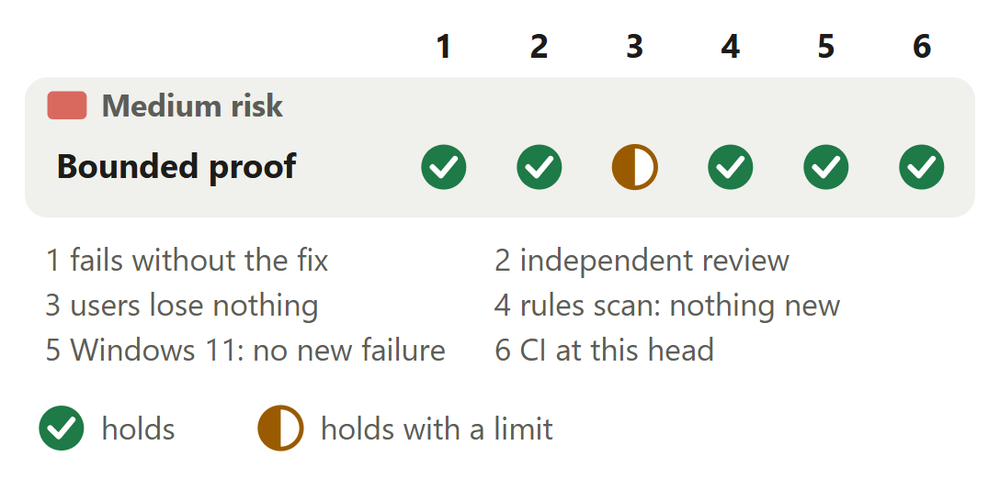

# Windows: a busy daemon's lookup answers in time and keeps daemon.json

For [pull request #677](https://github.com/neralabs/rerail/pull/677), head cf1a78a78. [report.html](report.html) is the same report as one page: download it and open it.

## 1. The decision

**On Windows, does a busy daemon's lookup answer within 2 s and keep `daemon.json`, with every start, stop and hook at `main`'s result or better?**

1. A busy daemon reads `alive but not answering` on every lookup, the fifth included.

**We recommend:** rule on #663 whether 2 s is the right wait, then review the squashed diff, which the automated reviewer approved at ff322959c.

| Size | Lane | Waits on | Not verified |
|---|---|---|---|
| 468 lines in 4 files: 129 ship, 339 are tests and text | Fast. The automated reviewer approved ff322959c; no person has reviewed it. | #663's answer. CI passes; no maintainer has answered there. | 4 |

## 2. Intent, and the gap

| Change | Intended | Found | Now |
|---|---|---|---|
| A busy daemon's record | A busy daemon keeps its record _(docs)_ | Fifth lookup: 30.2 s, record deleted _(real daemon, suspended)_ | Closes the gap, changes answer 1. |
| One daemon per home | No second daemon beside this home's _(docs)_ | Start and hook each left one _(the same daemon)_ | Closes the gap. |

Reported in #663 on 13 November 2026, from a Windows 11 machine with a real daemon suspended.

Sources at main, and causes

| Change | Where main states the intent | The cause, and what was measured |
|---|---|---|
| A busy daemon's record | `docs/windows.md` lines 439 and 440: "An engine that does not answer the proof in time is taken for a busy daemon: its state file is kept and the lookup reports it unresponsive." `src/runtime/daemon-control.ts` line 645, a code comment: "A busy daemon is waited for, not forgotten". | Node listens on a pipe with four free instances, and a stuck engine frees none. The fifth connect waits up to 30 s for one. `src/runtime/engine-proof.ts` line 89 arms the limit with `outgoing.setTimeout`, an idle limit that starts once the socket has connected and starts again at each byte read. The connect fails, line 93 reads that as `refused`, and `lookupDaemon` deletes the record. Windows 11 at `main` f277c6e29: the fifth `rerail status` took 30,247 ms. |
| One daemon per home | `docs/windows.md` line 411: "A holder that proves it is this home's engine stops the start: a second daemon must not run beside it." | Once the fifth lookup had deleted `daemon.json`, nothing named the running daemon, so a start, or a hook with autostart on, launched another, whose engine took the fallback pipe. Windows 11 at `main` f277c6e29: `rerail daemon start` exit 1 at 45,280 ms, a `PreToolUse` hook 60,188 ms, each with a second daemon alive 45 s later. At 424d5a55f, whose source this head keeps: 2,241 ms and 12,197 ms, no second daemon. |

## 3. Where to look

1. **Read first**, 10 min: `engine-proof.ts`: `connectPipe` with `pipeBusy`, `askForProof`, `engineHoldsCapability`. Can an alive daemon read `refused`, or any holder keep the asking process past its limit?

**Then skim**, 5 min: Seventeen commits: read the squashed diff; this head's source is 424d5a55f's. Nine new tests. `docs/windows.md` states the start's wait: ask 2.

## 4. Risk against verification

One half mark: a probe, not a test, measured the commands beside a real daemon.

Each half mark's limit

| Change | Check | It holds with this limit |
|---|---|---|
| Bounded proof | users lose nothing | A real daemon on Windows 11, `main` at c89f068ed against ff322959c, one or two runs a row: beside a busy daemon freed after 1, 8 or 20 s, and beside a holder that keeps every instance taken, the same exit codes and one daemon in every row. The limit: a probe measured these rows, and no test holds them. |

## 5. The changes

**Bounded engine proof on Windows**, medium risk: Fifth lookup of a busy daemon: 30.2 s and `daemon.json` deleted at `main`; 2.2 s and kept here.

<b>6. The decisions</b>

**How does the proof reach a pipe with no free instance?**

**We chose** Node's pipe client on the `\\?\pipe\` spelling: a busy pipe fails at once, and a close cancels a write. **Would change our mind:** a Windows or libuv change that brings Node's wait back: a named test then fails.

| Option | What a user gets | Cost | What it breaks |
|---|---|---|---|
| Node's connect to `\\?\pipe\<name>`, tried again every 50 ms **(chosen)** | A pipe with no free instance fails at once and reads `silent` at the limit. Closing the socket cancels a write a holder never reads: the process ends 6 ms after a 1 s limit. | 108 lines added and 21 removed, in one file. It rests on `WaitNamedPipe` taking only `\\.\pipe\` names. | Nothing found. Each failed try lists the machine's pipes to tell a busy pipe from a gone one. |
| A timer of its own and nothing else (3e8451d59) | The verdict comes at the limit. | 15 lines added and 7 removed in `engine-proof.ts`. | Node's wait for a free instance holds the process: `rerail status` answered at 2.2 s and ended at 30.1 s. |
| The pipe opened as a file (the first design, up to e2124df8b) | A busy pipe fails at once. | A write on such a pipe cannot be cancelled. 37bd79b0c removed it. | Beside a holder that takes the request and never reads it, the asking process lived 19 to 20 s. |
| A native overlapped open | A busy pipe fails at once, and a close cancels the write. | Rust on the lookup path. | Update and uninstall would load the engine's binary, whose folder they delete. Not built. |

Before: At main the fifth lookup of a busy daemon asks the proof, the connect finds no free instance and Node waits up to 30 s, the connect fails and reads as refused, and daemon.json is deleted. After: With this change the limit starts when the lookup asks the proof. The connect fails at once and is tried again every 50 ms. At the limit the proof reads silent, and daemon.json is kept: alive but not answering.

**Evidence.** A probe with Node 24.21.0 (libuv 1.52.1) on two Windows 11 builds. A pipe whose four instances are all taken: the `\\?\pipe\` connect fails with `ENOENT` in 0 to 1 ms on every try, and the process ends 6 to 8 ms after its last try. Spelled `\\.\pipe\`, the process ends at 30,070 and 30,047 ms. A pipe that does not exist gives `ENOENT` with either spelling, so a failed connect reads as busy only while the pipe is listed.

**How long does the engine start wait beside a held pipe?** (ask 2)

**We chose** 30 s, as `main`: 8 s gave a busy daemon of the same home a second daemon. **Would change our mind:** #657 merging: its lock per home makes a shorter wait safe.

| Option | What a user gets | Cost | What it breaks |
|---|---|---|---|
| 30 s, as `main` (424d5a55f, kept by this head) **(chosen)** | Beside a busy daemon of this home with no `daemon.json` that frees an instance at 20 s: exit 1 at 15,252 ms, then refused at 20 s, one daemon. `main` at 6cf7e5663: 15,260 ms, one daemon. | Beside a holder with no instance limit that keeps every instance taken: exit 1 at 15,617 ms, daemon up on the fallback pipe at 32.6 s. `main` at 6cf7e5663: 15,318 ms and 31.1 s. | Nothing against `main`. |
| 8 s, inside the command's 15 s (0fa6edae7) | Beside that holder: exit 0 at 9,598 ms. | It takes a busy daemon of this home for a holder of the name. | Beside the busy daemon freed at 20 s: exit 0 at 8,961 ms and two daemons, where `main` keeps one. |
| 8 s after #657's lock per home | Beside the busy daemon: exit 1 at 15,539 ms, one daemon (0fa6edae7 merged with #657 at 50705c972). | #657 merges first. Beside the holder it was not measured merged. | Not built here. |

**Evidence.** Windows 11, a real daemon from a checkout's build, a probe test added, times from the command's start. The rows ran again at ff322959c against `main` at c89f068ed. Beside the holder, two runs: exit 1 at 15,343 and 15,302 ms, daemon up at 31.5 and 31.3 s (`main`: 16,017 and 15,976 ms; 33.3 and 33.8 s). The busy-engine start test frees its instance at 20 s: with the wait at 8 s it answers false after 8,043 ms.

<b>7. How it fits</b>

It stands on `main` alone and merges clean at c89f068ed. Leaving draft waits on an answer to #663. Drafts #657 and #672 merge clean. The automated reviewer leaves a maintainer both asks.

**Trial merges and shared files.** `git merge-tree` of cf1a78a78 with each head, on 14 November 2026: `main` at c89f068ed, #657 at 2cb75efa0, #672 at 98c2462b6, #676 at 0ed1ad013, #656 at eb88b0dee and #678 at b9088adf5 are clean. #657 (ours, a draft, fixes #626) shares no file; its lock per home stops a second daemon for one home. #672 and #676 (ours, drafts) and #656 and #678 (ours, open) also edit `docs/windows.md`, in other lines. Of the 28 open pull requests, no other edits `engine-proof.ts` or its test file. Any order works.

<b>8. What is not covered</b>: 4 not verified, 6 smaller gaps, 7 limits that stay

1. **Unchanged from `main`:** beside a holder with no instance limit that keeps every instance taken, `rerail daemon start` fails at 15,318 ms; daemon up at 31.1 s (`main` 6cf7e5663). At 424d5a55f: 15,617 ms, 32.6 s.
2. **`ingestEngineEvent`, other code, left alone:** it arms its timeout the same way, so an event can meet Node's wait for a free instance.
3. **No test holds the real-daemon rows:** a probe measured them.
4. **macOS** never ran.

**Smaller gaps**

- **Seventeen commits, one diff.** Four, d214e3493 to 424d5a55f, replace the first design, the pipe opened as a file. 77c980de6 and 0fa6edae7 cut the start's wait to 8 s, ff322959c puts it back, and cf1a78a78 joins two release note sentences. The source and docs are 424d5a55f's. Pushed commits are not rewritten.
- **The limit itself is `main`'s.** This head keeps the 2 s default and counts the connect inside it. A longer limit would read a slow daemon as not answering less often, and hold every command beside a stuck daemon that much longer. Not built or measured: #663 asks.
- **How often it happens.** No count of daemons that stay busy through four lookups. A long audit or a suspended process does it. No published version has the defect: #503 brought the proof.
- **The lookup rows at ff322959c** ran on a second Windows 11 machine only: `rerail status` in 2,191 to 2,682 ms, the hook 12,316 ms. The first machine's figures are at 424d5a55f, whose source this head keeps.
- **The cost of telling busy from gone.** Each failed try lists the machine's pipes, every 50 ms until the limit. It was not timed apart: `rerail status` beside a busy daemon took 2,229 to 2,278 ms at 424d5a55f.
- **The release note** has two sentences and 58 words, as the changelog guide asks. No published version has the defect: #503 brought the proof, and the checklist says so. Say the note is not wanted, and it is dropped.

**Limits that stay**

- A busy daemon whose pipe has a free instance, a dead daemon, a refused pipe and a missing state file read as at `main`. A daemon that is gone reads so in 144 to 157 ms at 424d5a55f.
- macOS and Linux are unchanged: no lookup there asks the proof, and a path spelled like a pipe is a Unix socket's.
- A hook beside a busy daemon still waits out its own 12 s before it gives up, and logs its event as lost to a daemon that did not answer.
- The engine start can wait 30 s for a free instance and then 2 s for the answer, past the 15 s `rerail daemon start` gives the daemon, as at `main`.
- The fix rests on `WaitNamedPipe` refusing `\\?\pipe\` names. Should Windows or libuv change that, Node's wait returns, and the test "leaves its process free to end once it has answered, also when the engine's pipe has no free instance" fails.
- When the machine's pipes cannot be listed, a failed connect counts as busy, so a gone pipe would read `silent` until the limit, not `refused`. Read from the code, not run.
- The busy-engine start test takes about 20 s on every Windows run of its file: 20,188 ms at ff322959c.

## 9. What we ask of you

Ask 1 rules on answer 1.

1. **On [#663](https://github.com/neralabs/rerail/issues/663#issuecomment-6869803910): is the proof's limit, `main`'s default, the wait you want before a busy daemon reads as not answering?** We recommend yes: a longer one holds every command.
2. **Do you accept `main`'s 30 s engine start wait beside a holder that keeps every instance taken?** We recommend yes: 8 s gave a second daemon; shorter can follow #657.

<b>10. Evidence</b>

The description on GitHub is the record: "How you tested it" holds the runs and the real-daemon tables.

| Where | What ran | Result |
|---|---|---|
| CI on GitHub | Every job at cf1a78a78, run 43559967096, read on 14 November 2026 | 19 checks pass, none fails, 3 are skipped: the Rust engine, the conformance job and its comment. `CI result` passed at 05:28 UTC. Among the 19: `Unit tests (1/2)`, `Unit tests (2/2)`, `Unit tests (Windows, 1/2)`, `Unit tests (Windows, 2/2)` and `Integration tests`. `Unit tests (Windows, 2/2)` first failed on one test this change does not touch, in `test/runtime/merge-assist/runtime-notes.test.ts`, as on `main` at c89f068ed; its second attempt passed. |
| Windows 11 x64 | At ff322959c, Node 24.21.0: the change's test file and the 23 that test every caller of the proof and of `lookupDaemon` (20 unit files, 4 integration files) | 427 passed, 25 skipped, 0 failed, none outside `main`'s baseline. The busy-engine start test took 20,188 ms. |
| Linux x64 | At ff322959c: the 20 unit files, then the 4 integration files | 429 passed, 9 skipped, no regression against `main`. The integration files: 14 passed. The proof's seven Windows tests do not run there. |
| A second Windows 11 machine | At ff322959c: the proof's test file, then two copies of that commit with fix lines changed | 9 of 9 passed. With the wait at 8 s the start test fails at 8,041 ms. With a busy engine that takes two instances, both busy-engine tests fail on their check that every instance was taken. Without the destroy, the answer-before-read test takes 20,035 ms where 2,000 is allowed. |
| Windows 11 | Failing first: d3c33e631, `main` with the first tests, and d214e3493, the first design with four new tests | d3c33e631: two of six proofs `refused` after 30,022 ms, the lookup `absent` at 30,020 ms with `daemon.json` deleted, and no verdict for the trickling listener in 15 s. d214e3493: 3 failed, 5 passed; a holder that never reads kept the asking process alive 19,012 ms after its answer. |
| Windows 11 | A real daemon in a started repository, suspended, with no free pipe instance, at `main` f277c6e29 and at 424d5a55f, whose source this head keeps; a probe test added | `rerail status` six times: 2,229 to 2,278 ms, record kept (`main`: the fifth 30,247 ms, record deleted). A `PreToolUse` hook: 12,197 ms, no second daemon (`main`: 60,188 ms and a second daemon). `rerail daemon start` refuses in 2,241 ms (`main`: exit 1 at 45,280 ms, a second daemon). `rerail daemon stop` ends the daemon in 4,200 ms (`main`: finds nothing to stop). |
| Windows 11 | `rerail daemon start` beside a held pipe, a real daemon from a checkout's build, at `main` c89f068ed and at ff322959c, two runs where two numbers are given | A busy daemon with no `daemon.json`, freed after 1, 8 and 20 s: exit 1 at 1,189 ms, 8,142 ms, and 15,798 and 15,368 ms at `main`; 1,149 ms, 8,121 ms, and 15,296 and 15,331 ms here. A holder that keeps every instance taken: 16,017 and 15,976 ms at `main`, 15,343 and 15,302 ms here. One daemon in every row. |
| Linux x64 | The automated reviewer's rules scan over the diff against `main`, at ff322959c | No finding. The highest complexity of a function the change adds or edits is 5 (`connectPipe`). |

**What this report adds to the description**

- **`main` writes the intent down.** The description cites `docs/windows.md` once, for the second daemon. Part 2 adds the lines for the record: lines 439 and 440 say an engine that does not answer in time "is taken for a busy daemon: its state file is kept". So this closes a gap between the docs and the code, and changes no intent.
- **Our answer to the read-first question.** A read of the diff: `connectPipe` answers `refused` only for a connect error other than `ENOENT`, or once the pipe is no longer listed. A busy pipe that stays listed reads `silent` at the deadline. After the connect, `askForProof` reads a hang-up as `refused`, as `main` does. Its `finally` clears the timer and destroys the request with its socket. Only the challenge is sent, as at `main`.
- **A busy pipe is told from a gone one by a listing.** `pipeBusy` lists the machine's named pipes after each failed try, every 50 ms until the limit. The description gives no cost for it, and none was timed apart. When the pipes cannot be listed, `pipeListed` counts the pipe as there, so a gone pipe would read `silent`, not `refused`. Read from the code, not run.

**Sources.** Pull request #677, its diff, checks and reviews, and issue #663, read on GitHub on 14 November 2026. Rerail at `main` (c89f068ed) for each quoted intent and its line. The description for the runs and the timings. The heads of #657, #672, #676, #656 and #678 for the trial merges, made again for this report. The automated reviewer's review of ff322959c for its findings.

