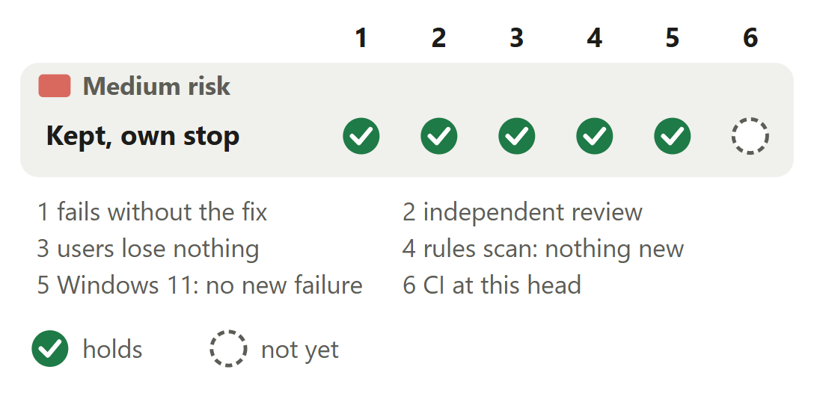

# A busy Windows daemon is kept; a stop ends only its daemon

For [pull request #677](https://github.com/neralabs/rerail/pull/677), head a5379a0a7. [report.html](report.html) is the same report as one page: download it and open it.

## 1. The decision

**Does a stop now end only processes a fact shows are this home's daemon, with lookups, starts and hooks' events at `main`'s result or better?**

1. A busy Windows daemon reads `alive but not answering` on every lookup.
2. A stop ends nothing when no fact shows the process is the daemon.

**We recommend:** rule on #663 how long a busy daemon is waited for, which Decision 6 asks of hooks too, then review the squashed diff.

| Size | Risk and review | Waits on | Not verified |
|---|---|---|---|
| 2,749 lines in 25 files: 830 ship, 1,919 are tests and text | Fast. One question on #663, then the stop's rule. | #663's answer. CI's result shows on this pull request's checks. | 4 |

## 2. Intent, and the gap

| Change | Intended | Found | Now |
|---|---|---|---|
| A busy daemon's record | A busy daemon keeps its record _(docs)_ | Fifth lookup: 30.3 s, record deleted _(real daemon, suspended)_ | Closes the gap, changes answer 1. |
| What a stop ends | A stop ends the home's daemon _(docs)_ | It ended a stale record's live program _(real daemon, killed)_ | Closes the gap, changes answer 2. |

The busy daemon: reported in #663 on 13 November 2026, from Windows 11. The stop: found in our runs on Linux x64 and Windows 11.

Sources at main, and causes

| Change | Where main states the intent | The cause, and what was measured |
|---|---|---|
| A busy daemon's record | `docs/windows.md` at `main`: "An engine that does not answer the proof in time is taken for a busy daemon: its state file is kept and the lookup reports it unresponsive." | Node listens on a pipe with four free instances, and a stuck engine frees none. The fifth connect waits up to 30 s for one. `src/runtime/daemon/engine-proof.ts` arms the limit with `outgoing.setTimeout`, which starts once the socket has connected. The connect fails, the proof reads that as `refused`, and `lookupDaemon` deletes the record. Windows 11 at `main` 7efcac9c6, with the 0.2.0 engine: the fifth `rerail status` took 30,256 to 30,777 ms. |
| What a stop ends | `docs/reference.md` at `main`: "`rerail daemon start` reuses a running daemon and says where; stale state from a crash or reboot is cleared." | `stopFoundDaemon` sent SIGTERM, then SIGKILL after 10 s, to the pid `daemon.json` records whenever a lookup kept the record, and a lookup kept it whenever the pid was alive and did not answer. A daemon killed without its cleanup leaves the record, and the system can give its pid to another program. |

## 3. Where to look

1. **Read first**, 20 min: `daemon-control.ts`: `recordedProcess`, `lockVerdict`, `startVerdict`, `holderWroteRecord`, `signalCheck`, `stopFoundDaemon`. Can a stop signal a pid no fact shows is the daemon, or forget a busy one?
2. 15 min: `engine-proof.ts`, `session-presentation.ts`, `hook-host.ts`, `home-daemon-lock.ts`, `process-liveness.ts`, `setup-cli.ts`, `cli.ts` and `index.ts`.

**Then skim**, 10 min: Tests at the lookup and stop seam on the Linux and Windows rules, a CLI case, and two release notes.

## 4. Risk against verification

Half mark: a probe, not a test, measured the real-daemon rows.

Each limit, and each check that does not hold yet

| Change | Check | Its limit, or why it does not hold yet |
|---|---|---|
| Kept, own stop | CI at this head | CI's result shows on this pull request's checks. |

## 5. The changes

**Busy daemon kept, own stop only**, medium risk: A killed daemon's record naming a live program: `main`'s stop ends it on Linux x64; here, nothing.

<b>6. The decisions</b>

**Which facts show a pid is this home's daemon?**

**We chose** the home's lock with its holder record, and the process's start against `startedAt`: both are kept by the system. **Would change our mind:** a daemon that records its own start on the boot clock would make the start exact through clock steps.

| Option | What a user gets | Cost | What it breaks |
|---|---|---|---|
| The lock with its holder record, then the start against `startedAt` **(chosen)** | A busy daemon of this release or of 0.1.4 is kept and ended by its stop. A killed daemon's record whose pid a later program has ends nothing. | A start read: two `/proc` reads on Linux, one Windows PowerShell `Get-Process` on Windows, only where the lock does not decide. | A clock stepped by more than 10 s on Linux misreads a lockless daemon (under what is not covered). |
| The lock with its holder record alone | No process is read. | Every daemon of 0.1.4 or earlier holds no lock. | A busy 0.1.4 daemon lost its record and kept running; a hook started a second daemon on Windows. |
| The command line | It names `--state-file`. | Native code or WMI on Windows. | Any program can carry any command line, and a relaunch or an older build differs. |

**Evidence.** Through the built CLI and a real daemon on Windows 11 and Linux x64: a busy daemon with the lock, without it, with an unwritable holder record, and a busy 0.1.4 daemon from npm were each kept and ended by `rerail daemon stop`; a record naming a live program started an hour later ended nothing.

**How long may a start read take?**

**We chose** what is left of the lookup's limit, or the stop's 10 s: a hook still answers within about 12 s. **Would change our mind:** a way to read a Windows process's start in this process without the engine's DLL.

| Option | What a user gets | Cost | What it breaks |
|---|---|---|---|
| What is left of the lookup's limit; the stop's 10 s for a stop **(chosen)** | A hung PowerShell is ended at the bound and reads nothing: the record kept, the stop ends nothing. | On Windows a lookup whose proof used its limit reads no start and keeps the record, as `main` does; the stop decides. | Nothing against `main`. |
| No bound | Every read finishes. | A synchronous PowerShell blocks the CLI, a hook or the uninstall. | A PowerShell that hangs holds a hook past its 12 s. |
| The engine's `GetProcessTimes` | No process started. | The engine's DLL loaded in the CLI. | The uninstall could not delete `versions/` after its stop. |

**Evidence.** Windows 11: one read by `Get-Process` takes a median of 300 to 368 ms beside other runs, about 170 ms more than the .NET call it replaces, which Constrained Language Mode refuses. A program standing in for PowerShell that never answers is ended at its bound, and a hook answers within about 12 s with the record kept.

<b>7. How it fits</b>

It stands on `main` alone and holds `main` at 7efcac9c6, with the 0.2.0 engine. Merging waits on #663. #672, #678, #656 and nine later changes edited its files; all are merged and in that `main`.

**Trial merges and shared files.** Merged: #672 as a08de26a9, #678 as dffb47a91, #656 as 285e5d837, each held by e8a6b0b5a (`git merge-base --is-ancestor`). `main` at 7efcac9c6, the 0.2.0 engine (#508), merged in at 6552849b1 with no conflict. #672 shared `daemon-control.ts`, `cli.ts`, the CLI's integration test and two docs pages; #678 `daemon-control.ts`, its test file and `docs/windows.md`; #656 `docs/windows.md`. Any order works.

<b>8. What is not covered</b>: 4 not verified, 6 smaller gaps, 4 limits that stay

1. **Clock steps on Linux:** a lockless busy daemon reads as another program after a forward step over 10 s; a program started before `startedAt` is ended, as at `main`.
2. **Where policy blocks `powershell.exe`:** a busy 0.1.4 daemon's stops end nothing, where `main`'s ended it.
3. **Real-daemon rows:** a probe measured them, no test.
4. **macOS** never ran; it reads no start time.

**Smaller gaps**

- **On Windows, a start read failing after the lookup's proof:** the stop ends nothing and says so, where `main` ends it; 0 of 20 stops met it.
- **A lookup on Windows** reads a start only with time left of its limit: after a silent proof `rerail status` keeps the record and a hook waits its 12 s, as at `main`. The stop decides.
- **A holder record naming the pid `daemon.json` names** beside a lock another daemon holds without recording itself reads as ours, as at `main`. A start after `daemon.json`'s record would overrule it, at one more PowerShell process per Windows stop of a busy daemon.
- **A healthy 0.1.4 daemon on Windows** is not seen, as at `main`: its engine predates the proof.
- **No `daemon.json` and a holder record naming an ended pid:** the stop says not running while the home's stalled daemon holds the lock, as at `main`.
- **Eighty-five commits, one diff.** Eleven merge `main`, four replace the proof's first design and three settle the engine start's wait. Pushed commits are not rewritten.

**Limits that stay**

- The engine start can wait 30 s for a free instance and then 2 s for the answer, past the 15 s `rerail daemon start` gives the daemon, as at `main`.
- `ingestEngineEvent` arms its timeout on a pipe connect, so an event can meet Node's 30 s wait for a free instance.
- Beside a daemon hung for good with every instance of its pipe taken, each hook waits about 32 s and keeps `daemon.json`; at `main` the first waits 60 s and deletes it. `rerail daemon stop` ends that daemon.
- A busy spell that begins while the pipe has free instances: the hook connects at once and waits 12 s in all, as at `main`; a 15 s spell loses its event at both.

## 9. What we ask of you

Ask 1 rules on answer 1.

1. **On [#663](https://github.com/neralabs/rerail/issues/663#issuecomment-6869803910): which wait do you want before a busy daemon reads as not answering, for commands and hooks?** We recommend 2 s for commands, `main`'s wait for hooks.

Answer 2 asks no ruling. It says how to check the process.

<b>10. Evidence</b>

The description on GitHub is the record: "How you tested it" holds the runs and the real-daemon tables.

| Where | What ran | Result |
|---|---|---|
| Windows 11 x64 | At e2900262d, `main` and d5c88bebe, 3 rounds each: the daemon's loop held 40 s, its instances free at first, under 20 prompt hooks with `RERAIL_ENGINE_SOCKET` set; every instance taken: busy 5, 15 and 40 s, hung for good | Delivered: `main` 48 of 60, d5c88bebe none, here 48; here every spell gives `main`'s count and keeps `daemon.json`. Hung for good, each hook here waits about 32 s (d5c88bebe 12 s; `main` 60 s once, record deleted). |
| Windows 11 and Linux x64 | At 1d5068c54: a busy Rerail 0.1.4 daemon stopped 20 times through the CLI, each start read logged; and with its reads refused from the third on | 20 of 20 ended on both, with one read deciding the SIGTERM. Refused from the third read: 9014dce8e said stopped with the daemon running (3 of 3, both systems); here Windows 11 ends it and Linux x64 keeps the record and says so (3 of 3). |
| Windows 11 x64 | At eec4cce67, Node 24.21.0: the changed modules' test files and every test file that imports one (30 unit, 7 integration) | 821 passed, 60 skipped, 6 failed, none in this change's behaviour: five OMP cases need a real OMP executable, and the engine proof's cost case measured 162 ms of work where 120 is allowed beside five other runs. `claude-hook-rules.test.ts` passed its 4 cases. |
| Linux x64 | At eec4cce67: the 30 unit files, then CI's integration job | Unit: 829 passed, 23 skipped, 0 failed. Integration with the OMP host installed: 22 files, 91 passed, 4 skipped, 0 failed. |
| Windows 11 and Linux x64 | Each fix line taken out alone, with the cases that cover it selected: 24 lines, then 7, then 12 at 1d5068c54 | Each fails 1 to 5 of its cases, on Windows 11 and on Linux x64; the PowerShell command's case runs on Windows only. |
| Windows 11 and Linux x64 | The new and changed cases, 20 rounds each, at eec4cce67 and at 1d5068c54 | 0 of 20 runs failed on either system at both heads (12 cases each at 1d5068c54); with the holder record's time read as the present, 20 of 20 failed. |
| Windows 11 and Linux x64 | A real daemon through the built CLI, 27 states, at `main` e8a6b0b5a and here; a probe test added | Of 27 states none gives less than `main`; a 28th, a stand-in refusing every start read as where policy blocks `powershell.exe`, does: a busy 0.1.4 daemon's stops end nothing. Busy daemons, 0.1.4's too, are kept and ended by their stop, also under Constrained Language Mode; a killed daemon's record naming a live program ends nothing. |
| Linux x64 | The automated reviewer's rules scan over the diff against `main`, at e4adffc0f | No new finding with either Rerail: 0 Steer, 0 Log, 0 complexity, and 0 differences with Rerail built from `main`. No verdict, since the published 0.1.1 cannot parse `test/cli/support-bundle.test.ts`, at the merge base too. Every function added or edited is at complexity 6 or under. |

**Sources.** The figures come from runs on a Windows 11 machine and a Linux x64 machine at the commits named, through the change's tests and a probe that drives the built CLI beside a real daemon; the code at the head wins over any text.

