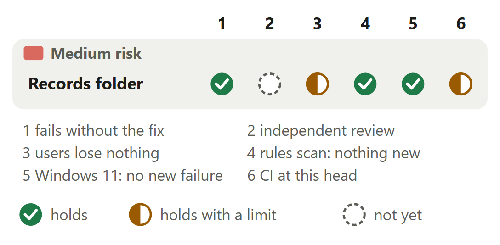

# Windows: session records stay each account's own whoever made their folder

For [pull request #920](https://github.com/neralabs/rerail/pull/920), head 22cd0b429. [report.html](report.html) is the same report as one page: download it and open it.

## 1. The decision

**May the daemon make each record in a `.rerail\sessions` another program made its maker's alone, earlier records included, while other accounts keep recording there?**

**We recommend:** approve it: on Windows 11 at `main` records were open to every local account in six of nine states, here only where the list cannot be changed; a second account still records.

| Size | Risk and review | Waits on | Not verified |
|---|---|---|---|
| 2,154 lines in 17 files: 1,206 ship, 948 are tests and text | High risk. `src/engine/storage/` is high-risk: a maintainer approves. | Nothing. No CI run on GitHub yet: not pushed. | 4 |

## 2. Intent, and the gap

| Change | Intended | Found | Now |
|---|---|---|---|
| The records folder's list | Records outside the profile stay private _(code comment)_ | A folder made first stays open _(runs on Windows 11)_ | Closes the gap. |

Found in November 2026 by reading the code, then shown with the published 0.1.4 and 0.1.5 and `main` on Windows 11.

Sources at main, and causes

| Change | Where main states the intent | The cause, and what was measured |
|---|---|---|
| The records folder's list | `src/engine/storage/ledger-paths.ts` at `main` 7efcac9c6, lines 76 to 84 (the quote), and line 68: `if (made && end === start + 2) keepFolderPrivate(folder, { ...machine, made })`. `docs/privacy.md` lines 158 to 160 promise the list for a folder Rerail makes. | Only the call that creates `sessions` sets its list (`made`). Git makes the folder for a repository whose commit carries a file in it; Rerail 0.1.4 left one in each checkout it ran in; a person may make it. Each takes its parent's list, which under `C:\` lets Users read and Authenticated Users change, and every record in it inherits that. The daemon start repairs the home only. |

## 3. Where to look

1. **Read first**, 8 min: `private-files.ts`: `keepFoundFolderPrivate`, `keepEachOwnersOwn`, `shareLikeParent`. Can any account list the folder or read another's record, and can one that recorded at `main` not record?
2. 10 min: `windows-acl.ts`, `ledger-paths.ts`, `runtime.ts`, `scrub-cli.ts`, `session-paths.ts`, `git_workspace.rs`: lists, callers, scrub, status.

**Then skim**, 5 min: The Windows runtime case grants Users on the checkout, so the records folder inherits it as under `C:\`; the other new cases fake the access list.

## 4. Risk against verification

Start at check 3: an entry set on the records folder itself for another account stays, and a folder Rerail cannot change is only logged.

Each limit, and each check that does not hold yet

| Change | Check | Its limit, or why it does not hold yet |
|---|---|---|
| Records folder | independent review | No review by anyone outside the change at this head. Each line was taken out in turn: the four Linux lines each fail one case, and the Windows cases fail at the earlier head. |
| Records folder | users lose nothing | A second account records in a shared checkout and keeps its repository reuse; none reads another's records. A session or lock folder another account made before the first repair keeps its list, as at `main`. |
| Records folder | CI at this head | No CI run at this head on GitHub yet: the branch is not pushed. Here, at this head: CI's lint job, rustfmt, both clippy commands and the engine's store cases pass. |

## 5. The changes

**Each account's records its own**, medium risk: Records in a `.rerail\sessions` Git made under `C:\`: every local account reads them at `main`; only their maker here.

<b>6. The decisions</b>

**Which list does a records folder Rerail did not make get, and when?** (ask 1)

**We chose** at the daemon's first session there: each record its maker's alone; who could make a folder there still can. **Would change our mind:** Accounts that share a checkout and mean to read each other's records.

| Option | What a user gets | Cost | What it breaks |
|---|---|---|---|
| Each record its maker's; accounts that could make a folder there still can **(chosen)** | Every account's records its own, earlier ones included; a second account keeps recording; none lists another's. | One `icacls` read per checkout per daemon life, and one per session while it fails; in the background once, one more read, a grant per lock or held-steer folder, one set. | A session or lock folder another account made before the first repair keeps the list it had, as at `main`. |
| The owner-only list on the records folder | The first account's records private, earlier ones included. | As built. | A second account's recording there: every hook of it failed (`EPERM`), measured with three accounts. |
| Leave the folder's list; each new session's folder gets its own | New records private. | One `icacls` per new session. | Names listed by every account; earlier records, held steers and locks open to all. |
| A lock and held-steer folder per account | As built, with no shared folder to grant. | A path change that `rerail scrub` and the held-steer lock read too. | Steers held in the shared folder at an upgrade. |

**Evidence.** Three local accounts on one Windows 11 machine, made and removed by the run: the first clones a repository that commits a file in `.rerail/sessions` and records, the second records, a third reads; at `main` cccb25a8d, the earlier head 93c4e2add and here. Nine states at the earlier heads.

**Who waits for a records folder's repair?** (ask 2)

**We chose** nobody: a session waits only for the list's read; one opening during the repair first gives its folder the list. **Would change our mind:** A records folder whose list takes more than a moment to read.

| Option | What a user gets | Cost | What it breaks |
|---|---|---|---|
| `execFile`, nobody waits; a session opening during the repair lists its own folder first **(chosen)** | Every event answered as at `main`: 839 and 747 ms at 360,000 entries, `main` 851 and 546 ms; each session's records private from the first byte. | One more `icacls`, on a new or nearly empty folder, per session that opens during a repair. | Nothing `main` gives. A `.gitignore` first written during the repair keeps the open list it took, as at `main`. |
| `execFile`, sessions opening in that checkout wait for the repair | The same lists. | At 360,000 entries the opening session and a second one gave up at the hook's 30 s. | Answers: no finding, steer or block reaches the agent at that boundary. |
| `execFileSync` with a 30 s limit | The same lists. | Every session on the daemon waits: 6.7 to 8.2 s at 40,000 entries; past 12 s a hook gives up and its event is not recorded. | Answers on every checkout of the daemon. |
| Wait for the repair up to a bound, then the session folder's own list | The same lists. | A wait up to the bound for each session that opens during a repair. | A clock decides what whether the repair runs already tells. |

**Evidence.** A records folder made by hand with 360,000 earlier files and folders: the first event there, a second session's 1 s later, and each session folder's list at its first record, on one Windows 11 machine at `main` 7efcac9c6 and here; 10,000 and 40,000 entries with the repair on the daemon's thread.

<b>7. How it fits</b>

Nothing merges first: `main` 6ec384ad9 is merged in; of what merged since 6b3990ba8 only #894 and #884 share a file, in other lines. #812, #883, #904 and #909 each merge with this head with no conflict.

<b>8. What is not covered</b>: 4 not verified, 6 limits that stay

1. **A live Claude Code session** did not run: the hook entry as built was fed the events Claude Code sends, and started a real daemon.
2. **A folder another account owns** was stood in for by one whose list denies its own change; the daemon's log named it and the hook went on.
3. **macOS** never ran; Linux x64 ran the same mode code.
4. **A second account on Linux** never ran: the engine cases and the storage cases stand in, by the folder's mode.

**Limits that stay**

- An entry someone set on `.rerail\sessions` itself for another account stays.
- A folder whose list this account cannot change stays as it is; each session there gets its own list. The log names it once; it is tried again when its owner or list changes, unless a new session folder follows.
- A records folder named by `RERAIL_STORAGE_ROOT` is used as it is, as before.
- A folder Git does not ignore that an account may not list still turns its repository reuse off, as at `main`: slower checks, the same results.
- A session, lock or held-steer folder another account made before the first repair stays as open as at `main` until its maker changes it; every account's hooks still lock there.
- A file a repository tracks in `.rerail\sessions` leaves the engine's view of the checkout, as one under `node_modules/` does at `main`.

## 9. What we ask of you

1. **Should a records folder another program made make each record its maker's alone, other accounts still recording there?** We recommend yes, as built: earlier records private, a second account still records.
2. **Should a session that opens during its records folder's repair go on at once, its own folder listed first?** We recommend yes, as built: no session waits; its records are private at once.

<b>10. Evidence</b>

The description's "How you tested it" holds the states at both `main`s and here, the large-folder times, the first-event times and the mutants.

| Where | What ran | Result |
|---|---|---|
| Windows 11 | Three local accounts made and removed by the run; a clone whose commit carries a file in `.rerail/sessions`, made by the first: `main` cccb25a8d, the earlier head 93c4e2add and here | `main`: the second records; it and a third list the folder and read the first's events. 93c4e2add: the second's hooks fail (`EPERM`), nothing recorded. Here: the second records; it and a third get `EPERM` on the folder and the first's records; the first on the second's. |
| Windows 11 | Nine states through the built hook entry and a real daemon, in a home of its own, a checkout under a folder that lets Users read: `main` ba0545900, `main` 7efcac9c6 and here | Both `main`s: six states open, 300 of 300 earlier records open. Here: eight states private, held-steer folders and `.gitignore` too; the folder whose list cannot be changed named in the daemon's log, hook exit 0. The content store private at all three. |
| Windows 11 | A records folder made by hand with 360,000 earlier entries: the first event there and a second session's, `main` 7efcac9c6 and here on one machine; 10,000 and 40,000 entries with the repair on the thread | At this head's code: 776 and 352 ms, each session's folder its owner's at its first record, the folder's own list after 40 s, then 0 of 40 earlier records open. The owner-only form: 839 and 747 ms, `main` 851 and 546 ms. 40,000: another checkout's prompts 210 to 429 ms through `execFile`, as at `main`. |
| Windows 11 | A session's first event in 20 checkouts each the daemon had not opened, 3 rounds, `main` 7efcac9c6 and here in turn | Median 724 ms at `main` (quartiles 678 to 759), 752 ms here (723 to 770), 60 each. |
| Windows 11 | The 19 test files of the change and its importers, here and at `main` 6ec384ad9 on one machine | Here 389 passed, 16 skipped; `main` 368 passed, 13 skipped; each vitest exit 0. |
| Linux x64 | The 19 files here and at `main` 6ec384ad9 | Here 391 passed, 14 skipped, vitest exit 0; `main` 369 passed, 11 skipped, 1 failed past its 5 s limit, which times out at both under load: run again in turn, since the machine took one start at a time, it failed once in 4 runs at `main` and once in 5 here. |
| Linux x64, Windows 11 | Each change taken out, red first | The new cases at 93c4e2add: 5 failed on Linux x64, 6 on Windows 11; the refused `.gitignore` case at a0557f254: 1 failed on each system. The four Linux lines each fail one case. Cases added at ee0358066, 4694d22c9 and here fail at the commit before: 3, 2 and 2 on Linux x64, 2 and 1 on Windows 11 for the first two; each of their 18 lines removed fails one. |
| Linux x64 | The automated reviewer's rules at `main` 6ec384ad9 over the diff | No new finding and no new complexity. |

**Sources.** The branch at 22cd0b429 and its diff against `main` 6ec384ad9, read on 20 November 2026; runs on Linux x64 machines and Windows 11 virtual machines; the published 0.1.4 installed from npm in a folder of its own.

