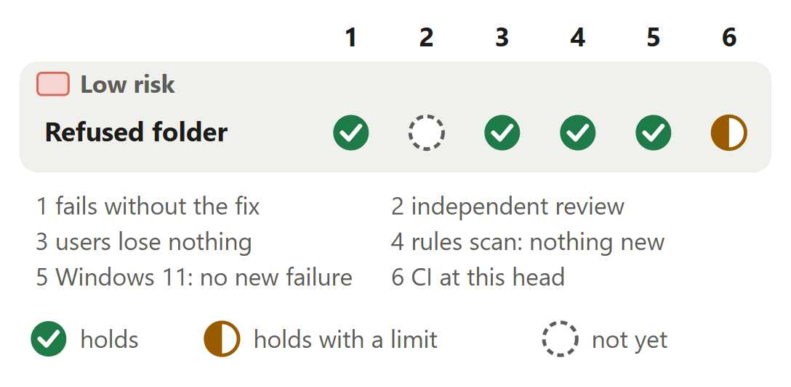

# A worktree without its main checkout keeps its record and is checked

For [pull request #977](https://github.com/neralabs/rerail/pull/977), head ae16c0d7e. [report.html](report.html) is the same report as one page: download it and open it.

## 1. The decision

**May a worktree whose main checkout was deleted or moved keep its recorded clone id, so its sessions are still recorded and checked?**

**We recommend:** approve it: such a session is recorded, steered by the repository's rules and keeps the worktree's settings; what only Git can tell is unknown there, and other folders are unchanged.

| Size | Risk and review | Waits on | Not verified |
|---|---|---|---|
| 1,065 lines in 11 files: 177 ship, 888 are tests and text | Careful. It decides which repository a folder Git refuses belongs to. | Nothing. No CI run here yet: the branch is not pushed. | 2 |

## 2. Intent, and the gap

| Change | Intended | Found | Now |
|---|---|---|---|
| Recorded worktree, recorded again | A recorded checkout stays that checkout _(code comment)_ | Moved to a new, stopped repository _(the issue's steps)_ | Closes the gap. |

Found on 17 November 2026 on Linux x64, in a test run of a session in such a worktree.

Sources at main, and causes

| Change | Where main states the intent | The cause, and what was measured |
|---|---|---|
| Recorded worktree, recorded again | `src/engine/catalog/repository-registry.ts` at 21f86868e: `recordedRepositoryAt` (the read path's rule, quoted) and `recordCheckout`, which calls `resolveCloneId` first; `src/engine/catalog/repository-identity.ts`, `repositoryIdentityLocation`, which reads Git's refusal of a folder as a folder outside Git. | Git refuses a worktree whose `.git` file names a deleted Git folder, so Rerail takes it for a folder outside Git, whose id lives in `.rerail/repository-id`. None is there, so the session's start wrote a new one; the recorded row held the old id, so the row and its settings were deleted and the folder recorded under a new repository nobody started. The start check, which reads no id file as the recorded row, had said started. |

## 3. Where to look

1. **Read first**, 5 min: `repository-registry.ts`: `recordCheckout`, `refusedCheckoutCloneId`. Can a folder that is not such a worktree ever take its recorded id?
2. 4 min: `git-placement.ts` and `repository-identity.ts`: `gitFolderReached`, `writtenForm`, `worktreeGitFolderGone`, `gitFindsNone`, `resolveCloneId`.

**Then skim**, 5 min: Registry cases for a deleted or moved main checkout; Git counts; a table of `.git` paths and 520 generated ones against Git's own; a placement count; a hook case.

## 4. Risk against verification

One change, low risk: only a linked worktree whose Git folder is gone takes its recorded id, and Git is not asked there.

Each limit, and each check that does not hold yet

| Change | Check | Its limit, or why it does not hold yet |
|---|---|---|
| Refused folder | independent review | No independent review of this head yet. |
| Refused folder | CI at this head | No CI run at this head on GitHub yet: the branch is not pushed. CI's lint and type-check job passes on Linux x64. |

## 5. The changes

**Refused worktree keeps its clone id**, low risk: Through a daemon, a session in such a worktree records its calls: `main` 0 of 14 runs, the change 14.

<b>6. The decisions</b>

**Record the session under the recorded checkout, or tell it nothing is recorded?**

**We chose** record and check it: its files are all there, and Rerail's own record still names the checkout. **Would change our mind:** A team that wants a deleted main checkout to end Rerail in its worktrees would take the second option, with its loss of checks.

| Option | What a user gets | Cost | What it breaks |
|---|---|---|---|
| Keep the recorded clone id for a linked worktree whose Git folder is gone **(chosen)** | The session recorded, steered and told its rule count under the worktree's repository; its start state and settings kept. | One read of `.git` and one indexed read when such a folder is recorded without an id file. | What only Git can tell there (branch, commits, a diff against a base) stays unknown; Rerail checks the folder as one outside Git. |
| Tell the session at its start that nothing is recorded | A true note, and no record. | A new note, and a state carried from the registry to it. | The repository's rules stop applying in a folder whose files are all there. |
| Keep the recorded id for every folder Git refuses | The same here; also a folder below a stray `HEAD` file or with `GIT_DIR` set keeps its record. | The same. | Changes folders that are not worktrees: a second behaviour change, with no run showing a gain. |

**Evidence.** The issue's steps through the built CLI, the built hook script and a daemon, each side built from its commit on one machine: `main` 21f86868e told the session Rerail is on, steered nothing and recorded no call, result or turn end in all 7 runs on Linux x64 and all 7 on Windows 11; the change at acdcb0c03 steered and recorded every run.

<b>7. How it fits</b>

Nothing has to merge first: it stands on `main` 1e80e3b04, merged in. #964 edits the hook test file too; Git merges the two alone, in either order.

**The files it shares.** #964 edits `test/hosts/claude/claude-hook.test.ts`. With its head d194de9e4, as a local clone held it on 21 November, the trial merge with this branch is clean. No other open pull request we checked edits these files.

<b>8. What is not covered</b>: 2 not verified, 4 smaller gaps, 2 limits that stay

1. **How often** people delete or move a main checkout and keep working in a worktree of it was not measured.
2. **macOS** never ran; its paths read as Linux's do, so the two forms are the same there.

**Smaller gaps**

- **Worktrees recorded elsewhere before.** A worktree an earlier version already recorded under a new repository stays there: a session in it is recorded nowhere, as on `main`.
- **A pruned entry.** Where the main checkout stays and Git pruned the worktree's entry, the daemon's upkeep forgets the worktree as on `main`, since Git no longer lists it; runs of an earlier form of this change.
- **Paths in no form Git writes.** A `.git` path with a `.`, a `..` after a name, an empty name, or on Windows no drive letter is left to Git, as on `main`: once its main checkout is gone, Git refuses the worktree and it takes a new clone id.
- **Three readers elsewhere.** The checkout owners, the registry's folder-name read and, on Windows for a relative path, the head reader still join a `.git` path as text, as on `main`; a change of their own.

**Limits that stay**

- A session that starts in a subfolder of such a worktree is not recorded: Rerail finds no checkout recorded at that folder, as before, and says nothing there.
- With a setting written into the database behind the running daemon, the next session's note leaves out the rule count, here and on `main`, in any worktree.

## 9. What we ask of you

We ask no ruling.

<b>10. Evidence</b>

The description on GitHub is the record: "How you tested it" holds the runs on `main` and here.

| Where | What ran | Result |
|---|---|---|
| Linux x64 and Windows 11 | The issue's steps through the built CLI, the built Claude Code hook and a daemon, `main` and the change at acdcb0c03 each built from its commit on one machine: main checkout deleted (5 runs) or moved away (2) | `main`: no rule count, no steer, nothing recorded, a new repository, in all 14. The change: "1 rule is on", steered, call, result and turn end recorded, the same repository, in all 14. |
| Linux x64 | Each line of the change taken out in turn, the changed test files run | Every one fails a case (vitest exit 1); the head passes them all. |
| Linux x64 and Windows 11 | A table of `.git` paths sorted into the forms Rerail answers and those left to Git, with a rooted path on a `subst` drive, and 520 generated spellings asked two ways, main checkout there and deleted, against Git's own | 57 table cases on Linux and 77 on Windows pass; no generated answer of 2080 differs from Git's on either system; with 8b078e157's placement module the `subst` case answers a live worktree outside Git and both comparisons fail. |
| Windows 11 | Every changed test file and every test file importing a changed module (21), engine built for this commit | 557 passed, 10 skipped, none failing; `main` 459 passed, 9 skipped. |
| Linux x64 | The same 21 test files at the head, and the 18 `main` holds at `main` 1e80e3b04, on one machine | Here 512 passed and 32 skipped, none failing; `main` 433 passed and 30 skipped. |
| Linux x64 and Windows 11 | The change's case that counts each placement's file-system calls on the repository's folders and its Git processes, against `main` 1e80e3b04 | The same counts as on `main` for a worktree as `git worktree add` writes it and its main checkout, on three Linux machines and on Windows 11. |
| Linux x64 | The automated reviewer's rules over the diff against `main` 1e80e3b04 | No new finding; every function it adds or edits is at 6 or under. |
| Linux x64 | CI's lint and type-check job at the head | `just --fmt --check`, the release-note check, `npm run check`, `check:ui-tokens` and `check:reference` pass. |

**Sources.** The branch at 8bf492405 and its diff against `main` 1e80e3b04, read on 21 November 2026; runs on Linux x64 machines and Windows 11 machines.

